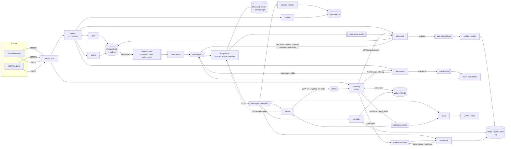

# xmsg: Architecture & Technology Plan

A Slack-style messenger built to hold **1,000,000 concurrent online users**, that other companies can also **run on their own infrastructure**.

- **Scope for v1:** workspaces, public and private channels, DMs, group DMs, threads, reactions, and broadcast channels (one-to-many, read-only for most members).
- **Security model:** TLS in transit plus encryption at rest. No E2EE, so the server can search, sync and moderate.
- **Deployment:** one codebase, **three tiers** [ADR-0019]: **Small** (one VM, Docker Compose, ≤ 10k users) and **Medium** (Helm on the customer's Kubernetes, ≤ 100k users) for self-hosting customers; **Large** (1M concurrent) is how we run our own service. Unless a section says otherwise, sizes and platform choices in this plan describe the Large tier; §12 describes Small and Medium.
- **Licensing:** **open core** [ADR-0022]. The messenger is open source (server AGPL-3.0; clients, SDKs and schemas Apache-2.0) as the **Community Edition**; SSO/SCIM, the admin console and compliance features are the commercial **Enterprise Edition**.
- **Later, with room left in the design:** media and files, voice and video, bots and webhooks, regional edges, multi-region data.

**How to read this document:** it describes *what* we build. The reasons behind each major choice are in the [decision records (ADRs)](adr/README.md), linked inline as `[ADR-00xx]`. The review history is in `architecture-review*.md`; the previous version of this plan is in [archive/architecture-plan-v1.md](archive/architecture-plan-v1.md).

---

## 1. Design targets (Large tier)

| Metric | Target | Notes |
|---|---|---|
| Concurrent connections | 1M (designed for 1.5M) | ~1.3 per user; depends on open question 1 |
| Registered users | 10–20M | |
| Messages sent | 20k/s sustained, 100k/s peak | |
| Deliveries after fan-out | 1–2M/s, 5M/s peak | ~50 online recipients per message on average |
| Delivery latency | p50 < 100 ms, p99 < 500 ms end to end | Server side ~15–30 ms (§9) |
| Availability | 99.95% | One region, 3 availability zones |
| Largest channel | 500k members | Pull-mode delivery (§5.6) |

**Storage (per day at 20k msg/s):** ~1.7B messages ≈ 0.9 TB raw at ~500 B per row. With ×3 replication, ~3× compression, and copies in OpenSearch and Kafka: **~2–3 TB of disk per day**. On top of that, fixed state: the sequencer's RocksDB stores (1–2 TB NVMe per instance) and their changelogs on Kafka (~0.3–1.2 TB including ×3 replication).

All sizing comes from these targets and gets re-checked after the Phase 0 and Phase 3 load tests.

---

## 2. Architecture overview



**Rules that hold everywhere:**
1. **Every channel change is a sequenced event.** Messages, edits, reaction batches, membership changes and channel metadata all go through `messages.in` and the sequencer [ADR-0002].
2. **Kafka is the source of truth**, with one writer per channel. Scylla, Redis, OpenSearch and every cache are derived from `messages.persisted`.
3. **Each table or store has one writer.** Membership tables and thread followers: persister. Settings: `settings-writer`. Read positions: the user's `readstate` owner. Sequencer state: the sequencer. §7 labels every table with its writer.
4. **Derived state is set, never incremented**, so replays are harmless.
5. **Delivery is best-effort; correctness comes from sequence numbers plus sync.** NATS can drop messages; gateways and clients detect gaps [ADR-0009].
6. **Interactive actions take a fast path; the outbox is the safety net** [ADR-0010].

---

## 3. Technology stack

| Layer | Choice | ADR |
|---|---|---|
| Realtime gateway | **Elixir 1.20 / OTP 29**, Bandit WebSockets, `gnat` (NATS), `brod` (Kafka), `redix` | [0001](adr/0001-language-split.md) |
| Sequencer | **Kotlin + Kafka Streams**, JDK 27, Generational ZGC | [0003](adr/0003-kafka-streams-sequencer.md) |
| Other services | **Rust**: tokio, axum, tonic/prost, `rdkafka`, `sqlx`, `scylla`, `fred`, `async-nats`, `opensearch`, `a2` | [0001](adr/0001-language-split.md) |
| Clients | **TypeScript + React** (web), **Tauri** (desktop), **React Native** (mobile), shared TS sync core | [0011](adr/0011-two-step-sync-and-local-first-client.md) |
| Protocols | WebSocket + Protobuf to clients; NATS request/reply gateway → services; gRPC between Rust services; Buf for schemas | [0001](adr/0001-language-split.md) |
| Event log | **Apache Kafka** (Strimzi in Large; bundled in Small/Medium); any Kafka API service with transactions, e.g. Redpanda, MSK | [0002](adr/0002-kafka-single-writer-sequencer.md), [0020](adr/0020-pluggable-backends.md) |
| Realtime delivery | **NATS** core | [0009](adr/0009-nats-delivery-and-gap-detection.md) |
| Postgres → Kafka | **Transactional outbox**, relayed by **Debezium** (Large) or the built-in **Rust outbox poller** (Small/Medium) | [0010](adr/0010-outbox-with-fast-path.md), [0020](adr/0020-pluggable-backends.md) |
| Messages, membership, settings, read state | **Wide-column store (CQL):** Apache Cassandra 5 bundled in Small/Medium; for Large, **ScyllaDB (commercial licence) or Cassandra 5, decided by a Phase 0 benchmark** | [0007](adr/0007-membership-in-scylla.md), [0016](adr/0016-member-settings-kafka-first.md), [0023](adr/0023-osi-bundled-backends-and-wide-column-choice.md) |
| Relational data | **PostgreSQL 17+** (CloudNativePG) + PgBouncer | |
| Presence, caches, rate limits | **Valkey** (bundled; any Redis-protocol service works) | [0023](adr/0023-osi-bundled-backends-and-wide-column-choice.md) |
| Search | **OpenSearch** | |
| Object storage (later) | S3 API (MinIO / Ceph / cloud) + CDN | |
| Edge | Cloud NLB TLS or HAProxy (TCP) + MetalLB; **Envoy Gateway** for HTTP | [0013](adr/0013-tls-at-the-load-balancer.md) |
| Network (Large tier only) | **Cilium** CNI with transparent **WireGuard** node-to-node encryption | [0017](adr/0017-network-layer-encryption.md) |
| Platform (Large tier only; optional elsewhere) | Linkerd (mTLS between services; not on the gateway's WebSocket port), cert-manager, External Secrets + Vault/OpenBao, Argo CD + Rollouts, Helm, Terraform/OpenTofu, Harbor | [0019](adr/0019-self-hosting-and-deployment-tiers.md) |
| Editions | Community (AGPL-3.0 server, Apache-2.0 clients) and Enterprise (commercial `ee/` code, offline-verified licence keys); separate CE and EE images | [0022](adr/0022-open-core-licensing.md) |
| Self-hosting packaging | Docker Compose bundle (Small), Helm chart with bundled-or-external backends (Medium), `xmsgctl` CLI, later a Kubernetes operator | [0019](adr/0019-self-hosting-and-deployment-tiers.md) |
| Observability | OpenTelemetry, Prometheus (+ Thanos/Mimir), Grafana, Loki, Tempo, Alertmanager, Sentry | |
| Testing | k6, custom Rust WebSocket swarm (1M clients), Chaos Mesh, Testcontainers, `TopologyTestDriver` | |
| Analytics | Deferred past v1 (Postgres or SaaS first, ClickHouse later) | |

Every stateful dependency is reached through a **compatibility contract** (Kafka API with transactions, CQL, PostgreSQL 15+, Redis protocol, NATS, OpenSearch/Elasticsearch API, S3 API), so self-hosters can bring their own services; tested implementations and their licences are listed in [ADR-0020](adr/0020-pluggable-backends.md). **Everything bundled in either edition is OSI-licensed open source** [ADR-0023]; source-available products (ScyllaDB, Redpanda, some Redis versions) are supported only as the customer's own choice.

**Naming in this plan:** "Scylla" means the wide-column store behind the CQL contract (Cassandra 5 or ScyllaDB), and "Redis" means the Redis-protocol cache (Valkey by default).

---

## 4. Event model

Everything in §5–§7 builds on this section.

### 4.1 Topics and partitioning
- `messages.in` (input) and `messages.persisted` (sequenced output) are keyed by `channel_id` with **N partitions, fixed per installation**: Small 16, Medium 64, Large 512 [ADR-0004], [ADR-0021]. Changing N is a planned migration (`xmsgctl migrate-partitions`), never an in-place resize.
- **Partition function:** `partition(channel_id) = toPositive(murmur2(8-byte big-endian channel_id)) % N`, Kafka's default. Clients get N in the connection handshake. Rust uses librdkafka `partitioner = murmur2_random`; Elixir and TypeScript implement it; all four languages pass shared test vectors in CI.

### 4.2 Event and command types
| Kind | Types | Produced by |
|---|---|---|
| Messages | `message.created`, `message.edited`, `message.deleted`, `thread.reply` | `messages` |
| Thread following | `thread.followed`, `thread.unfollowed` (manual follow/unfollow) | `messages` |
| Reactions | `reactions.batch{adds, removes, counts}` | `reaction-batcher` → sequencer |
| Membership commands | `member.join_requested`, `invite_requested`, `kick_requested`, `role_change_requested` | `channels` |
| Membership events | `member.joined`, `member.left`, `member.role_changed` | sequencer |
| Channel lifecycle | `channel.created{initial_members}`, `channel.updated`, `channel.archived`, `channel.mode_changed` | `channels` (fast path) / `meta-relay` / sequencer |
| Moderation | `message.delete_requested` (admin, GDPR, retention) | `messages`, admin and retention jobs; deletions consult the retention / legal-hold hook first (legal hold, EE, blocks retention and erasure deletes) |
| Outcomes | `message.rejected`, `command.rejected` | sequencer |

### 4.3 What every sequenced event carries
- `channel_id`, `workspace_id`
- **`event_seq`**: increases on every event. **For clients it is monotonic, not contiguous:** some events are deliberately not sent to every client (§4.4), so a jump is never treated as loss. Clients use it to order events, build the sync token and ask for "events after X". Detecting lost deliveries is the gateway's job [ADR-0009].
- **`msg_seq`**: increases only on new top-level messages (and thread replies sent to the channel); used for history and unread counts [ADR-0005].
- `reply_seq` for thread replies.
- **`membership_version`**: the `event_seq` of the channel's latest membership change [ADR-0006].
- **`fanout_mode`**: `push` or `pull` [ADR-0008].
- `message_id` (Snowflake: ms timestamp, partition, counter) for messages.
- The outbox event ID or `client_msg_id` it was deduped by.
- For `thread.reply`: the root's `message_id` **and** `msg_seq` (kept in the sequencer's `threads` store), so the persister can update the root row by its full key.

### 4.4 Who receives which events
| Event | Gateways | Clients viewing the channel | Other members |
|---|---|---|---|
| Messages, edits, deletes, reaction batches | all (push: per gateway; pull: `ch.{id}`) | full event | push mode: full event; pull mode: "channel updated" bump (≤ 1 per 5 s) |
| `thread.reply` | all | reply-count update (full reply for followers) | followers: full reply |
| `member.*` in push-mode channels | all | full event | full event |
| `member.*` in pull-mode channels | all (updates the gateway index) | batched member-count update | nothing |
| `channel.*` | all | full event | full event |

Gateways receive every event of the channels they serve, so they can detect gaps; clients may see `event_seq` jump.

---

## 5. Services

### 5.1 Gateway (Elixir)
- **Capacity:** ~100k connections per pod, ~20 pods (8 vCPU / 16 GB) for 1.5M. 30–60 KB per connection; idle processes hibernate after ~15 s. BEAM: raised `+P`/`+Q`, schedulers matched to the CPU limit, `+sbwt none`. Kernel: high fd limits, port range, `somaxconn`, conntrack.
- **TLS** (Large tier) is terminated before the gateway [ADR-0013]; in the Small tier the single gateway pod terminates TLS itself, and in Medium the customer's ingress does [ADR-0019]; the LB → gateway hop is encrypted by WireGuard at the node level, and the WebSocket port is **outside the Linkerd mesh** so its 100k connections don't pass through a sidecar [ADR-0017]. No distributed Erlang; pods are independent.
- **Encode once:** each event is encoded to Protobuf once per gateway and the same binary is sent to every recipient process (shared refc binaries), never re-encoded per connection. At target load a pod delivers ~50k–250k frames/s on 8 vCPUs.
- **Keepalive:** ping every 30 s; drop the connection after 2 missed pings.
- **Connect:** the first frame carries the JWT and `protocol_version` (below the minimum → "upgrade required"). No valid auth within 5 s → close; pre-auth connections capped per IP. Issues a ~5-minute **resume token**.
- **Sessions:** publishes `session.connected/disconnected` and the client's foreground/background `app_state` to `sessions.events` (compacted by `conn_id`). This is the only session registry. Heartbeats `gateway.alive.{id}` on NATS every 2 s, and re-announces its sessions after a NATS reconnect.
- **Subscriptions:** `gw.{gateway_id}`, `ch.{channel_id}` for pull-mode channels its users are in, `auth.revocations`, and refcounted `presence.{user_id}`.
- **Commands:** forwards sends, edits, reactions, mark-read and membership actions over NATS request/reply (queue groups, deadlines). Publishes typing to `typing.{partition}`. Per-connection limits on sends, typing and syncs.
- **Tokens:** asks for an in-band token refresh ~2 minutes before expiry; disconnects if none arrives. On `session.revoked`, `user.banned` or `workspace.member_removed`, closes the affected connections immediately.
- **Gap detection** [ADR-0009]: tracks a sequence per fan-out stream `(partition, owner_epoch)`, checks `stream_heads` every second, and uses `event_seq` on `ch.*`. On a gap, sends `resync{partition}`; after a NATS reconnect or slow-consumer event, sends `resync` to everyone.
- **Pull-mode index:** for each connecting user, reads `channels_by_user` (with `fanout_mode`) and joins their pull-mode channels: subscribe to `ch.{id}` first, buffer, read the snapshot with its `membership_version`, then apply buffered events newer than it. Unsubscribes when the last local member leaves.
- **Operations:** admission control (e.g. 2k new sessions/s per pod); deploys drain connections with jitter over ~5 minutes, rolling 4–5 pods at a time (~25 minutes for 20 pods instead of ~100); bounded send queue per connection (slow clients are dropped and resync).

### 5.2 `auth` (Rust + Postgres)
- Signup, login (argon2id, magic link, Google/GitHub OAuth), device sessions. SSO/SCIM later via Ory or Keycloak.
- **Identity-provider interface:** CE ships email + password, magic links and Google/GitHub OAuth; EE adds SAML, OIDC and LDAP as implementations of the same interface, plus enforced SSO per workspace [ADR-0022].
- 15-minute Ed25519 JWTs and rotating, hashed refresh tokens; JWKS for local validation. Envoy validates JWTs for HTTP, the gateway for WebSockets.
- Revocations (`session.revoked`, `user.banned`) go to the outbox **and** straight to NATS `auth.revocations` (fast path). `workspace.member_removed` comes from `users` the same way and uses the same NATS subject.

### 5.3 `users` (Rust + Postgres)
- Users, profiles, workspaces, workspace roles, invites. Profile cache in Redis, invalidated by `users.events`.
- **Workspace removal** (§6.5): revoke first, then a background job kicks the user from each channel.

### 5.4 `channels` (Rust + Postgres)
- Channel metadata (name, topic, type, archive state, pins) and `dm_pairs` in Postgres, changed through the outbox. Ordered metadata changes reach `messages.in` through the fast path and `meta-relay`.
- **Creates channels and DMs** with `channel.created{initial_members}` (§6.2).
- **Membership:** turns user actions into membership commands, waits for the result on `commands.results` (every instance reads the whole small topic; 2 s timeout with a "pending" answer), and never writes membership tables itself [ADR-0006].
- **Personal settings** (mute, notification level) are written **Kafka-first** [ADR-0016]: `channels` validates the change and produces `member.settings` (absolute values; key `user_id:channel_id`, partitioned by `user_id`). Its **`settings-writer`** consumer is the only writer of `member_settings` in Scylla; the compacted topic is the durable record. A settings row without a membership row is ignored; a cleanup job removes orphans.

### 5.5 `messages` (Rust)
- **Send:** best-effort checks (membership from Redis/LRU, permissions, rate limits, size, `@channel` rules) → `messages.in` (`acks=all`, idempotent producer) → `accepted` to the sender. The sequencer makes the final membership check.
- **Edit/delete:** only the author edits; the author or a channel admin deletes. Reads the target at `LOCAL_QUORUM`; if it isn't there yet but its `msg_seq` ≤ the channel head, retries for up to ~200 ms. Admin deletes are commands checked by the sequencer. Events carry the target's `msg_seq` (or `thread_root` + `reply_seq`).
- **Reactions** go to `reactions.in` (§6.8).
- **Reads:** history by `msg_seq`, thread replies, single messages, and the sync API (§6.6). Read paths check workspace membership as well as channel membership.

### 5.6 Sequencer (Kotlin + Kafka Streams)
[ADR-0002], [ADR-0003], [ADR-0005], [ADR-0006], [ADR-0008]
- One stream task per partition; `exactly_once_v2`; `commit.interval.ms` 5–10; static membership, warm-up replicas, 1 standby per task.
- **Assigns** `event_seq`, `msg_seq`, `reply_seq`, `message_id`, `membership_version`, `fanout_mode`.
- **Validates:** posts and `thread.followed` from non-members → rejected; posts or commands for unknown channels are rejected; membership and admin-delete commands are checked against the `members` store; outcomes go to `commands.results`.
- **Creates channels** from `channel.created` (dedupe by outbox event ID; no-op if it exists).
- **Decides fan-out mode** with hysteresis (pull at ≥ 1,000 members, push below 800) and emits `channel.mode_changed`.
- **Dedupes** `client_msg_id` within 15 minutes.
- **Explicit names:** every processor, state store and changelog topic is named explicitly in code and treated as a versioned contract, so an upgrade can't silently start with empty stores. CI runs an upgrade test (version N → N+1, state must survive) for every release, and the sequencer checks at startup that its expected changelogs exist and aren't empty unless the installation is new [ADR-0003].
- **State stores** (RocksDB + compacted changelogs): `channel_heads` (counters, version, mode, member count; last `message_id` per partition), `members` (`(channel_id, user_id) → role`; 1–4B keys, ~0.2–0.8 GB per partition, ~100–400 GB changelog), `threads`, `reaction_counts`, `dedupe` (windowed, 15 min). Restored from changelogs, never from Scylla, except in disaster recovery [ADR-0014]. **Store and changelog values are versioned** (a version byte plus Protobuf, checked by `buf breaking`); every sequencer upgrade that changes a format includes a migration step in its runbook.
- **Membership endpoint:** Interactive Queries over gRPC, serving a channel's current members (fallback snapshot source for fan-out).

### 5.7 `persister` (Rust)
- Consumes `messages.persisted`; idempotent upserts; absolute values, never increments.
- **Only writer** of `members_by_channel`, `channels_by_user` and `thread_followers` (followers are added on replies and mentions and changed by `thread.followed`/`thread.unfollowed`, all in channel order, so a replay ends in the same state).
- **Membership write order:** membership rows first, then `channel_heads.membership_version`, both at `LOCAL_QUORUM`. Produces the derived `channels.membership` feed afterwards.
- Writes `channel_heads`, then raises `chan_head` in Redis with a raise-only Lua script.
- **No overwrites by design:** `message_id` is part of the clustering key of `messages` and `thread_messages`, so two different messages with the same `msg_seq` (possible only after a disaster recovery) become two rows instead of one overwriting the other. No read before write is needed. History reads that find two rows for one `msg_seq` report them to `persister.quarantine` and alert [ADR-0014].

### 5.8 `fanout` (Rust)
- Consumes `messages.persisted` and `sessions.events`; receives typing and receipts on NATS `typing.{partition}` / `receipts.{partition}` for the partitions it owns.
- **In memory:** a per-connection session map (`conn_id → user_id, gateway_id`) and membership for active channels on its partitions, applied from `member.*` events in order. Cold channels load membership from Scylla only if its `membership_version` is new enough, otherwise from the sequencer's endpoint; only if both fail does it hold that channel.
- **Delivery:** push mode → one batch per gateway on `gw.{id}`; pull mode → once on `ch.{id}`; for ~10 s after a mode change, both. Every batch carries `(partition, owner_epoch)` and a sequence; `stream_heads` every 1 s.
- **Re-checks membership on every delivery.** Keeps a **deny list** of `(user_id, workspace_id)` from `workspace.member_removed` and drops that workspace's deliveries to the user until the kick job emits `workspace.member_removal_completed`. Both events are published by `users` through its outbox, so on restart the deny list is rebuilt from `users.events` (7-day retention).
- **Gateway liveness:** a silent gateway is suspect after 3 missed heartbeats; its sessions are dropped after ~60 s. A janitor tombstones sessions of gateways that are gone.

### 5.9 `presence` (Rust + Redis + NATS)
- Online/away from sessions plus client activity pings, with TTLs in Redis. Lazy: users get updates only for people on screen, through refcounted `presence.{user_id}` subscriptions per gateway, released ~30 s after the last local viewer stops watching so scrolling doesn't churn NATS.
- Typing: gateway → `typing.{partition}` → owning fan-out; throttled to 1 per 3 s; dropped if anything is slow.

### 5.10 `readstate` (Rust + Scylla)
[ADR-0012]
- **One writer per user:** all read-position updates (mark-read, own sends, mark-unread, joins, mentions) go through `readstate.events` keyed by `user_id`; only the owner of that partition writes `read_state`, merging positions with max.
- **Feeding the owner:** a separate `readstate` consumer group reads `messages.persisted` (partitioned by channel) and **never writes `read_state`**. It turns joins (start at the join's `msg_seq`), own sends and mentions into `readstate.events`. It may insert `user_mentions` rows directly, since those are idempotent inserts; `last_mention_seq` on the `read_state` row is set only by the owner.
- **Unread** = `chan_head.msg_seq − last_read_msg_seq`. **Mentions** are rows in `user_mentions` and `channel_mentions`, counted after `last_read_msg_seq`, with `last_mention_seq` to skip unchanged channels.
- **Read receipts** (DMs and group DMs): `receipts.{partition}` on NATS, coalesced to 1/s per user per channel.
- Thread read state per follower in `thread_read_state`.

### 5.11 `push` (Rust)
- Consumes `messages.persisted` and `sessions.events`. Notifies a user only if no connection is in the foreground, the channel isn't muted and their rules match.
- **Owns `push_subscribers`** (members with notification level "all"), built from the `channels.membership` feed and `member.settings`. Mention-only users come from mention rows; thread replies go to followers. Membership is checked again before sending.
- **Self-hosted installs send pushes through the xmsg push relay** that we operate, because the store apps are signed with our keys. Relay pushes carry only IDs, never message text; the app fetches content from the customer's server. Customers with their own white-labelled apps can send to APNs/FCM directly [ADR-0019].
- APNs (HTTP/2) and FCM, per-channel token bucket, burst collapsing, retries with backoff, dead-letter topic.

### 5.12 `search` and `search-indexer` (Rust + OpenSearch)
- Indexer consumes `messages.persisted` into monthly indices routed by workspace; documents carry `workspace_id`, `channel_id`, `is_private`. Public ↔ private switches run `update_by_query`.
- Queries: public channels by one workspace clause; private channels, DMs and group DMs from a per-user cached list (from `channels.membership`, capped at 1,000, post-filter beyond). Results are re-checked against workspace and channel membership.

### 5.13 Small services
| Service | Purpose |
|---|---|
| `meta-relay` | Copies ordered metadata events from the outbox topics into `messages.in`; forwards revocations to NATS |
| `reaction-batcher` | Partition-owned batching of reactions into `reactions.batch` [ADR-0015] |
| `ratelimit` | Envoy global rate limits backed by Redis |
| `admin` | CE: basic user, workspace and channel administration, bans. EE: admin console with custom roles, workspace policies, usage analytics, bulk operations, audit log viewer and export |
| `scim` *(EE)* | SCIM 2.0 user and group provisioning through the core provisioning API |
| `compliance` *(EE)* | Per-channel retention policies, legal hold, eDiscovery export, DLP webhooks |
| `audit` | Writes security events to append-only storage |
| Later | `media` (presigned S3, scanning, thumbnails, CDN), `integrations` (bots, webhooks, slash commands) |

---

## 6. Key flows

### 6.1 Send a message
1. Client shows the message instantly (pending) and sends `SendMessage{channel_id, client_msg_id, body}`.
2. Gateway → `messages` (NATS): early checks → `messages.in` → `Ack{accepted}`.
3. Sequencer: dedupe, membership check, assign counters and `message_id`, commit to `messages.persisted` (5–10 ms intervals).
4. In parallel: fan-out delivers (including the sender's other devices); persister writes Scylla and `chan_head`; `readstate` turns the send and any mentions into `readstate.events`; `push` and `search-indexer` do their parts.
5. Clients order by `msg_seq`. A `message.rejected` turns the pending message into a visible error with the reason; it is never dropped silently.

### 6.2 Create a channel or DM
1. `channels` commits the Postgres row (plus `dm_pairs`) and an outbox `channel.created{initial_members}` in one transaction.
2. It immediately produces the same event to `messages.in` (fast path); the outbox copy follows via Debezium and `meta-relay`.
3. The sequencer creates the channel and its initial members in one event; duplicates are deduped.
4. The client gets the `channel_id` right away; a first message waits in the local outbox until `channel.created` arrives (a few ms).

### 6.3 Change membership
`channels` sends a command → sequencer validates → `member.*` event or rejection → result on `commands.results` → persister writes membership rows then version → fan-out and gateways apply it in channel order. Nothing sequenced after a removal reaches the removed member [ADR-0006].

### 6.4 Revoke a session or ban a user
`auth` commits plus outbox, and publishes to `auth.revocations` immediately; gateways close sockets within about a second. Target: revocation-to-disconnect p99 < 5 s.

### 6.5 Remove a user from a workspace
1. `users` commits plus outbox (the event lands in `users.events`) and publishes `workspace.member_removed` fast-path to `auth.revocations`. Gateways close that workspace's connections, `auth` stops issuing tokens for it, and fan-out adds the user to its deny list for that workspace.
2. A job reads the user's `channels_by_user` rows for the workspace and sends idempotent `member.kick_requested` commands at a controlled rate.
3. Read paths check workspace membership throughout. When all kicks are done, the job emits `workspace.member_removal_completed` (also through the `users` outbox) and the deny-list entry expires.

### 6.6 Reconnect and sync
[ADR-0011]
1. Reconnect with backoff and jitter; resume token if still valid; admission control spreads load.
2. **Cheap step:** sync token (or server cursor above ~1,000 channels) compared with `chan_head` in Redis for the user's channels → changed channels, heads, unread and mention counts. No bodies.
3. **Lazy step:** only the open channel (and up to 5 recent ones) fetch `channel_events` after their last `event_seq`; message pointers are filled from `messages`. Too large a gap, or older than 30 days → load the latest page and mark the gap.
4. Clients keep `max(local, server)` for heads and read positions; a server head below the client's means "server behind".
5. The same cheap step runs on `resync` (only the named partition's channels), on foreground, and every 30 minutes in the background.

### 6.7 Large and broadcast channels
[ADR-0008]
- Pull mode above 1,000 members (back to push below 800), switched with `channel.mode_changed` and a 10 s dual-publish overlap; gateways dedupe by `event_seq`.
- Viewers get full events; other members get at most one "channel updated" bump per 5 s. Membership changes update gateway indexes; viewers only see a batched member count (§4.4).
- Only the `poster` role posts in broadcast channels. `@channel`/`@here` are off in broadcast channels, admin-only by default elsewhere, with confirmation above 1,000 members; each costs one `channel_mentions` row.

### 6.8 Reactions
[ADR-0015]
Client shows the reaction instantly → `reactions.in` (keyed by channel, with a per-user operation counter) → `reaction-batcher` emits one `reactions.batch` per message and emoji per second → sequencer applies it with absolute counts → persister sets `reaction_counts`. Pull-mode channels show counts plus the user's own reaction; "who reacted" loads on demand.

### 6.9 Threads
Replies are `thread.reply` events on the channel's partition with an `event_seq` and `reply_seq` (no `msg_seq` unless also sent to the channel). Followers (root author, repliers, mentioned users, plus manual follows, which the sequencer accepts only from channel members) get the reply and a Threads-view unread; channel viewers get the reply count. Manual follow and unfollow are sequenced `thread.followed` / `thread.unfollowed` events, so the persister applies every follower change in order. `reply_count` is set from the sequencer's value.

---

## 7. Data model

### 7.1 PostgreSQL
```
users(id, email, password_hash, name, avatar_url, created_at, ...)
workspaces(id, name, slug, plan, settings_json, created_at)
workspace_members(workspace_id, user_id, role, joined_at)        PK(workspace_id, user_id)
channels(id, workspace_id, type, name, topic, is_archived, created_by, created_at)
dm_pairs(user_low, user_high, channel_id)                        PK(user_low, user_high)
devices(id, user_id, platform, push_token, last_seen_at)
refresh_tokens(id, user_id, device_id, token_hash, expires_at, revoked_at)
outbox(id, aggregate_type, aggregate_id, event_type, payload, created_at)   -- kept 7 days
```
Membership and per-membership settings are not in Postgres [ADR-0007], [ADR-0016]. The rest can be sharded by `workspace_id` later.

### 7.2 Wide-column store (CQL: Cassandra 5 or ScyllaDB)
Compaction is set per backend: Incremental Compaction (ICS) on ScyllaDB, Unified Compaction (UCS) on Cassandra 5; small read-heavy tables may use LCS. Deletes clear the body and set `deleted = true`; GDPR and retention deletions go through the pipeline as commands so clients and search see them.

```sql
-- Writer: persister
CREATE TABLE messages (
  channel_id bigint, bucket int,            -- bucket = msg_seq / 10000
  msg_seq bigint, event_seq bigint, message_id bigint, author_id bigint,
  body text, attachments frozen<list<attachment>>,
  reply_count int, last_reply_at timestamp, edited_at timestamp, deleted boolean,
  PRIMARY KEY ((channel_id, bucket), msg_seq, message_id)   -- message_id in the key: no overwrites (§5.7)
) WITH CLUSTERING ORDER BY (msg_seq DESC, message_id ASC);

CREATE TABLE thread_messages (
  channel_id bigint, thread_root bigint, reply_seq bigint, message_id bigint, author_id bigint,
  body text, also_sent_to_channel boolean, edited_at timestamp, deleted boolean,
  PRIMARY KEY ((channel_id, thread_root), reply_seq, message_id)
);

-- Writer: persister (replies, mentions, thread.followed / thread.unfollowed in channel order)
CREATE TABLE thread_followers (channel_id bigint, thread_root bigint, user_id bigint,
  PRIMARY KEY ((channel_id, thread_root), user_id));

CREATE TABLE channel_heads (
  channel_id bigint PRIMARY KEY,
  event_seq bigint, msg_seq bigint, last_mention_seq bigint,
  membership_version bigint, fanout_mode text, channel_type text
);

-- 30-day event log for sync; message.created and thread.reply stored as pointers only
CREATE TABLE channel_events (
  channel_id bigint, bucket int,            -- bucket = event_seq / 10000
  event_seq bigint, type text, payload blob,
  PRIMARY KEY ((channel_id, bucket), event_seq)
) WITH default_time_to_live = 2592000;

-- Membership: the persister is the ONLY writer
CREATE TABLE members_by_channel (channel_id bigint, user_id bigint, role text, joined_at timestamp,
  PRIMARY KEY (channel_id, user_id));
CREATE TABLE channels_by_user (user_id bigint, workspace_id bigint, channel_id bigint,
  channel_type text, fanout_mode text, joined_at timestamp,
  PRIMARY KEY (user_id, workspace_id, channel_id));

CREATE TABLE channel_mentions (channel_id bigint, msg_seq bigint, kind text,
  PRIMARY KEY (channel_id, msg_seq)) WITH CLUSTERING ORDER BY (msg_seq DESC);

CREATE TABLE reactions (channel_id bigint, message_id bigint, emoji text, user_id bigint,
  PRIMARY KEY ((channel_id, message_id), emoji, user_id));
CREATE TABLE reaction_counts (channel_id bigint, message_id bigint, emoji text, count int,
  PRIMARY KEY ((channel_id, message_id), emoji));

-- Writer: readstate owner for the user (read_state, thread_read_state);
-- user_mentions rows are idempotent inserts and may also come from the readstate feeder
CREATE TABLE read_state (user_id bigint, channel_id bigint,
  last_read_msg_seq bigint, last_mention_seq bigint,
  PRIMARY KEY (user_id, channel_id));
CREATE TABLE user_mentions (user_id bigint, channel_id bigint, msg_seq bigint,
  PRIMARY KEY ((user_id, channel_id), msg_seq)) WITH CLUSTERING ORDER BY (msg_seq DESC);
CREATE TABLE thread_read_state (user_id bigint, channel_id bigint, thread_root bigint,
  last_read_reply_seq bigint, PRIMARY KEY (user_id, channel_id, thread_root));

-- Writer: settings-writer (one owner per user) [ADR-0016]
CREATE TABLE member_settings (user_id bigint, channel_id bigint,
  notify_level text, muted boolean, updated_at timestamp,
  PRIMARY KEY (user_id, channel_id));

-- Writer: push
CREATE TABLE push_subscribers (channel_id bigint, user_id bigint,
  PRIMARY KEY (channel_id, user_id));
```
Membership reads used as snapshots, and the persister's membership writes, use `LOCAL_QUORUM`.

### 7.3 Redis protocol (Valkey by default)
```
presence:{user_id}       online | away (TTL)
chan_head:{channel_id}   event_seq, msg_seq, last_mention_seq (raise-only cache over channel_heads)
members:{channel_id}     cache for early checks in `messages`
rl:{scope}:{key}         rate-limit counters
```

### 7.4 Kafka topics
| Topic | Key | Partitions | Retention |
|---|---|---|---|
| `messages.in` | channel_id | N (Large: 512), fixed per installation | 3 days |
| `messages.persisted` | channel_id | N, fixed per installation | 7 days |
| Sequencer changelogs: `channel_heads`, `members`, `threads`, `reaction_counts`, `dedupe` | store key | N each | compacted (`dedupe` windowed, 15 min) |
| `reactions.in` | channel_id | N | 1 day |
| `commands.results` | request_id | 16 | 1 hour |
| `sessions.events` | conn_id | 128 | compacted |
| `readstate.events` | user_id | 128 | 1 day |
| `member.settings` | `user_id:channel_id`, partitioned by user_id | 64 | compacted (the durable record) |
| `channels.membership` (derived, by persister) | channel_id | 64 | compacted |
| `users.events`, `channels.meta`, `auth.events` (outbox) | aggregate id | 32–64 | 7 days |
| `persister.quarantine` | channel_id | 8 | 30 days |
| `audit.events` | workspace_id | 32 | 30 days, then object storage |

### 7.5 NATS subjects
`gw.{gateway_id}`, `ch.{channel_id}`, `typing.{partition}`, `receipts.{partition}`, `presence.{user_id}`, `auth.revocations`, `gateway.alive.{gateway_id}`, `stream_heads.{gateway_id}`, and request/reply subjects per service.

---

## 8. Reliability

### 8.1 Failure handling
| Failure | What happens | Where |
|---|---|---|
| Sequencer crash or rebalance | Old owner fenced; standby takes over in seconds; no duplicate counters | [ADR-0003] |
| NATS drops a batch | Gateway sees a sequence gap or `stream_heads` mismatch → partition-scoped resync | [ADR-0009] |
| Gateway pod dies | Clients reconnect with resume tokens; fan-out drops its sessions after ~60 s | §5.1, §5.8 |
| Persister lags | Fan-out uses the sequencer's membership endpoint; delivery continues; alert | [ADR-0006] |
| Redis failover | Heads re-read from `channel_heads`; raise-only writes; clients keep max | §5.7 |
| Postgres failover | Failover slots keep Debezium's position; reconciler republishes gaps | [ADR-0010] |
| Kafka cluster lost | Restore from MirrorMaker 2 (`read_committed`), run sequencer recovery mode; message keys prevent overwrites | [ADR-0014] |
| Whole region lost | Degraded service in a second region in ~4–8 h; full history in 1–3 days | [ADR-0018] |
| Channel crosses the push/pull threshold | 10 s dual publish; dedupe by `event_seq` | [ADR-0008] |

### 8.2 Recovery targets
Targets depend on **what is lost** [ADR-0018]:

| Failure scope | Data loss (RPO) | Recovery time (RTO) | How |
|---|---|---|---|
| **One availability zone** | None | Minutes | Replication factor 3 across 3 zones; no restore |
| **One cluster corrupted** (bad migration, operator bug) | ≤ 1 min | Hours: Postgres ≤ 15 min; Kafka ≤ 1 h (MirrorMaker 2 + sequencer recovery mode); Scylla restore + replay from Kafka scales with size | Backups + replay; [ADR-0014] |
| **Whole region** | ≤ 1 min (MirrorMaker 2 lag) | **Degraded service in ~4–8 h** (new messages, membership, unread; recent 7 days of history); **full history in 1–3 days**; search rebuilt last | Off-region backups + standby Kafka; [ADR-0018] |

Presence, sessions and caches are never backed up; they rebuild on reconnect.

**Backups and copies:** Scylla Manager snapshots more often than every 7 days (inside Kafka's replay window); CloudNativePG WAL archiving; both in object storage **replicated to a second region**. MirrorMaker 2 (`read_committed`) copies Kafka to a **small standby Kafka cluster in the second region** (7 days of `messages.persisted`, sequencer changelogs, compacted topics); no services run there.

**Drills:** quarterly restore drills (zone loss, cluster restore, Kafka loss); a **yearly region-loss drill** into a scratch environment in the second region, following the region-loss runbook.

---

## 9. Performance

### 9.1 Latency budget (same region)
| Step | Budget |
|---|---|
| Client ↔ edge (network, each way) | 5–150 ms (5–40 ms with regional edges later) |
| LB → gateway → NATS → `messages` | ~2 ms |
| Kafka produce (`acks=all`, cross-AZ) | 3–5 ms |
| Sequencer consume + commit | 8–15 ms |
| Fan-out → NATS → gateway | 3–6 ms |
| **Server total** | **~15–30 ms** (alert if p50 > 40 ms or p99 > 150 ms) |

Rules: no synchronous database calls on the send path; no per-message WebSocket compression; every hot-path change runs a latency benchmark in CI.

### 9.2 Local-first client
Optimistic send, reactions, edits and reads; instant open from the local database; prefetch of likely channels and unread mentions; a local outbox with a 10-minute automatic retry limit (inside the 15-minute dedupe window), after which the user retries with a new `client_msg_id`; decoding and sync off the main thread; virtualized lists; fast reconnect with resume tokens and TLS session tickets.

### 9.3 Later optimizations
- **Regional edge gateways** (Phase 5): gateways and TLS in regional PoPs, NATS leaf nodes, GeoDNS or anycast; saves 50–150 ms per round trip for distant users.
- **Merge sequencer and fan-out** (Phase 3 experiment): saves one Kafka hop (~3–6 ms) but means fan-out logic in the JVM; adopt only if p50 improves by ≥ 5 ms without hurting p99 at 1.5× load. Never deliver before commit.

---

## 10. Security
- **In transit:** TLS 1.3 from clients to the edge (WebSockets at the LB, HTTP at Envoy), HSTS; **WireGuard node-to-node encryption** (Cilium) for all traffic between nodes, including LB → gateway; Linkerd mTLS between services (the gateway's WebSocket port is outside the mesh); TLS to Kafka, Redis, Postgres and Scylla [ADR-0017].
- **Self-hosted tiers** don't rely on Cilium or Linkerd. Every internal connection the app makes (gRPC, NATS, Kafka API, Postgres, CQL, Redis) can use TLS with certificates from the customer's CA or generated at install, and client TLS ends at the gateway (Small) or the customer's ingress (Medium) [ADR-0019].
- **At rest:** KMS-backed or LUKS volumes; backups encrypted with keys in Vault; SSE on object storage.
- **Sessions:** 15-minute tokens refreshed in-band; revocations close sockets within seconds.
- **AuthZ:** workspace and channel membership checked on every read and write; the sequencer is the final check for writes; search results re-checked.
- **Sockets:** 5 s auth timeout, pre-auth caps per IP, per-connection command limits, admission control.
- **Abuse:** rate limits per user, IP and workspace; size limits; spam heuristics as a Kafka consumer.
- **Compliance:** audit log; per-workspace export; a workspace-wide retention setting (CE) and per-channel retention, legal hold, eDiscovery export and DLP hooks (EE) [ADR-0022]; GDPR erasure through pipeline commands, complete within 7 days (Kafka retention) across Scylla, OpenSearch, Kafka and client caches.
- **Supply chain:** Trivy/Harbor scanning, cosign signatures, SBOMs, Renovate.

---

## 11. Infrastructure and operations (Large tier)

**One region, 3 availability zones**; every stateful system spans all three with replication factor 3. A second region holds only replicated backups and a small standby Kafka cluster [ADR-0018].

| Node pool | Workloads | Size at full load |
|---|---|---|
| `gateway` | Elixir gateways | ~20 pods, 8 vCPU / 16 GB |
| `services` | Rust services (HPA, KEDA on Kafka lag) | ~20–40 nodes, 8 vCPU / 16 GB |
| `sequencer` | Kafka Streams, RocksDB on NVMe, 1 standby per task | ~8–16 instances, 8 vCPU / 32 GB, 1–2 TB NVMe |
| `kafka` | Strimzi brokers + Kafka Connect | 6–9 brokers, NVMe, 16 vCPU / 64 GB |
| `scylla` | Wide-column store: ScyllaDB (commercial licence) or Cassandra 5, per the Phase 0 benchmark | ScyllaDB: 6–9 nodes, NVMe, 16–32 vCPU / 128 GB. Cassandra 5: expect more nodes (benchmark decides) |
| `postgres` | CloudNativePG (PostgreSQL 17+), primary + 2 replicas, PgBouncer | 3 × 16 vCPU / 64 GB |
| `redis` | Valkey cluster | 6 primaries + 6 replicas |
| `nats` | NATS cluster | 3–5 nodes |
| `search` | OpenSearch | 3 masters + 6–9 data nodes |
| `observability` | Prometheus, Loki, Tempo, Grafana | 4–6 nodes |
| Second region (standby) | Small Kafka cluster for MirrorMaker 2; replicated object storage | 3 brokers; no services |

- Stateful systems run on dedicated NVMe node pools with operators; each has a named managed fallback (Aiven Kafka, ScyllaDB Cloud, managed Postgres). **Budget item:** if the benchmark picks ScyllaDB, its commercial licence (or ScyllaDB Cloud) is a recurring cost, since the cluster is far above the free-use limit [ADR-0023].
- PodDisruptionBudgets and AZ spread everywhere. Gateways scale on connection count; consumers on Kafka lag.
- **Kafka partition count:** three 512-partition topics plus five 512-partition sequencer changelogs, plus the smaller topics: **~4,300 partitions, ~13,000 replicas at RF 3**, about 1,400–2,200 per broker on 6–9 brokers. Fine for KRaft; size broker memory and file handles for it.
- **Ops load:** six self-managed stateful systems plus Kafka Connect. Budget at least 1–2 platform engineers from Phase 0.
- Environments: `dev` (k3d), `staging` (small but complete), `prod`.

### 11.1 Observability and SLOs
- **Metrics:** RED per service; gateway connections, queue depth, admission rejections, resync hints; NATS slow consumers; Kafka lag; sequencer commit latency, fencing, rebalances, restore and standby lag; persister lag and quarantine count; fan-out snapshot holds; end-to-end delivery latency (stamped at send and delivery).
- **Tracing:** OpenTelemetry across gateway → messages → Kafka → sequencer → fan-out → gateway.
- **SLOs:** send-ack p99 < 300 ms; delivery p99 < 500 ms; connection success > 99.9%; history fetch p99 < 200 ms; revocation-to-disconnect p99 < 5 s.
- **Synthetic checks:** canary bots send and receive every 10 s.

---

## 12. Deployment tiers and self-hosting
[ADR-0019], [ADR-0020], [ADR-0021]

### 12.1 Tiers
| | **Small** | **Medium** | **Large** |
|---|---|---|---|
| Who runs it | Customer | Customer | Us (SaaS) |
| Users / concurrent | ≤ 10k / ≤ 5k | ≤ 100k / ≤ 50k | 10–20M / 1M+ |
| Packaging | Docker Compose on one VM (8 vCPU / 32 GB) | Helm chart on 3+ nodes | §11 |
| Partitions (N) | 16 | 64 | 512 |
| Event log | Apache Kafka, 1 node (bundled) | Apache Kafka, 3 nodes (bundled) or customer's Kafka API service | Kafka, 6–9 brokers |
| Wide-column store | Cassandra 5, 1 node (bundled) | Cassandra 5, 3 nodes (bundled), or customer's ScyllaDB / Cassandra / managed | ScyllaDB or Cassandra 5 (Phase 0 benchmark) |
| Cache | Valkey (bundled) | Valkey (bundled) or customer's Redis-protocol service | Valkey cluster |
| Postgres | Bundled | Bundled or managed (RDS, Cloud SQL, …) | CloudNativePG |
| Outbox relay | Rust poller | Rust poller (or Debezium) | Debezium |
| Sequencer | 1 instance, no standby | 2–3 instances, 1 standby | 8–16 instances |
| Gateway | 1 pod, terminates TLS itself | 2–3 pods behind the customer's ingress | ~20 pods behind an L4 LB |
| Search | Optional (1-node OpenSearch) or off | OpenSearch/Elasticsearch, bundled or customer's | OpenSearch cluster |
| Redundancy | None; backups with `xmsgctl` | Across nodes (and zones if available) | 3 zones + off-region backups |
| Platform layer | None | Customer's own | Cilium/WireGuard, Linkerd, Vault, Argo CD |

The services, event model and data model are the same in every tier. Only sizes, packaging and which backends are bundled change.

### 12.2 What self-hosters get
- **Images:** multi-arch (amd64/arm64), signed, with SBOMs.
- **Small:** one Docker Compose bundle with an install script (generates secrets and config, creates topics with N = 16, runs migrations). For the gateway's TLS certificate the script asks: **ACME (Let's Encrypt)** for internet-facing installs, or a **customer-provided certificate** for internal ones.
- **Medium:** one Helm chart. Every bundled dependency can be switched off and pointed at an external service (e.g. `kafka.enabled=false`, `externalKafka.bootstrap=...`). Startup checks each backend against its contract [ADR-0020] and fails with a clear message if a feature is missing.
- **Upgrades:** versioned releases with a stated upgrade path; Postgres and Scylla schema migrations and sequencer state-format migrations run as jobs. A Kubernetes operator automates this later.
- **Air-gapped installs:** an offline image bundle and chart; nothing calls home except the optional push relay.
- **`xmsgctl`:** backup and restore (Postgres, Scylla, Kafka compacted topics), health checks, support bundles, and `migrate-partitions` to move up a tier during a maintenance window [ADR-0021].
- **Enterprise identity (EE):** SAML/OIDC SSO, LDAP and SCIM, plus the admin console (moved forward to Phase 2).
- **Observability:** Prometheus metrics, OTLP traces and structured logs for the customer's own stack, plus ready-made Grafana dashboards.
- **Push:** through our relay (§5.11), or directly for white-labelled apps. **Air-gapped installs get no mobile push with the store apps**, since they can't reach the relay; the sizing docs say this plainly, and the options are white-labelled apps with the customer's own APNs/FCM credentials, or no push.

### 12.3 Editions (open core)
[ADR-0022]

| | Community Edition (open source) | Enterprise Edition (commercial) |
|---|---|---|
| Messaging, search, mobile, push | Everything | Same, plus push relay SLA |
| Tiers | Small and Medium, including multi-node HA | Same, plus supported upgrades and tier migrations |
| Sign-in | Password, magic links, Google/GitHub OAuth | SAML, OIDC, LDAP, enforced SSO |
| Provisioning | Invites | SCIM |
| Administration | Basic | Admin console, custom roles, policies, analytics |
| Compliance | Workspace retention, GDPR erasure | Per-channel retention, legal hold, eDiscovery, audit viewer/export, DLP hooks |
| Support | Community | Commercial tiers |

- **Licences:** server core AGPL-3.0; clients, TS sync core, Protobuf schemas and SDKs Apache-2.0; `ee/` code under a commercial licence (source-available in the same repository). Contributors sign a CLA.
- **Builds:** CE images contain only core code (EE excluded through Cargo features, Gradle/Mix configuration and the web build); EE images include `ee/` code, which stays off until a licence key is installed.
- **Licence keys:** Ed25519-signed files checked offline (air-gapped installs work), listing customer, expiry, seats and features. When a key expires, rules apply **per feature** [ADR-0022]: SSO, LDAP and SCIM keep working (only their configuration is locked); admins always have break-glass recovery codes; **legal holds and retention policies stay enforced indefinitely** (only editing them is locked); eDiscovery and audit exports stop; admin extras turn read-only. Messaging and CE features are never affected.
- **Checks are server-side**, in EE code paths behind core extension points: the identity-provider interface (`auth`), the provisioning API (SCIM), policy hooks (`channels`, `messages`), the retention / legal-hold hook (deletion commands), and the `audit` stream.
- Our own SaaS (Large tier) runs EE.

### 12.4 What it costs us
- **A CI test matrix:** every release runs the integration and chaos suites on at least Small (Kafka, single-node Cassandra 5, Valkey, poller) and Large (Kafka, the chosen wide-column store, Debezium), plus contract tests for each supported external backend (ScyllaDB, Redpanda, MSK, RDS, Redis, Elasticsearch). CI also checks that CE bundles contain only OSI-licensed components, runs the sequencer upgrade test, and tests each licence-expiry rule. Performance targets are stated for the Large tier only.
- **No hidden dependency on our platform:** every feature must work without Cilium, Linkerd or Vault. Anything that doesn't is a bug.
- **A shared service to run:** the push relay.
- **Two editions to build and test:** CI builds CE and EE images, runs both test suites, and checks that CE images contain no `ee/` code.
- **Licence hygiene:** SPDX headers on every file; dependency licences checked for AGPL and commercial compatibility (`cargo deny`, Gradle and npm licence checks); a CLA bot on the public repository.
- **Product work:** install and sizing docs, upgrade notes per release, a support process, push relay terms and fair-use limits, and pricing (open questions).

---

## 13. Repository and engineering
```
xmsg/
  proto/            Protobuf (Buf) + partition-function spec and test vectors
  services/
    gateway/        Elixir (Mix)
    sequencer/      Kotlin + Kafka Streams (Gradle)
    auth/ users/ channels/ messages/ persister/ fanout/ presence/
    readstate/ push/ search/ search-indexer/ meta-relay/ reaction-batcher/
    outbox-poller/ push-relay/   Rust
                    (channels/ includes the settings-writer consumer)
    */ee/           Enterprise code inside a service (e.g. auth/ee/ for SAML, OIDC, LDAP)
  ee/               Enterprise-only services and UI: scim/, compliance/, admin-console/, licence/
  crates/           shared Rust libraries
  clients/          web/ (React), mobile/ (React Native), core/ (shared TS sync engine)
  deploy/           compose/ (Small tier, also local dev), helm/ (Medium, and Large's base), argocd/, terraform/
  tools/loadgen/    Rust WebSocket swarm
  tools/xmsgctl/    Rust CLI: backup, restore, health, migrate-partitions
  docs/             this plan, adr/, reviews, archive/
  LICENSE, LICENSE-APACHE, ee/LICENSE   AGPL-3.0 core, Apache-2.0 clients/SDKs, commercial ee/
```
- One Cargo workspace, one Mix project, one Gradle project; Protobuf generated for Rust, Elixir, Kotlin and TypeScript.
- **Two editions:** CE builds exclude every `ee/` path; EE builds include them. CI builds and tests both, verifies CE images contain no EE code, checks SPDX headers and dependency licences, and requires a signed CLA on every pull request.
- CI: `cargo fmt/clippy/nextest/deny`; `mix format`, `credo`, `dialyzer`; `ktlint`, `detekt`, `TopologyTestDriver`; `buf breaking`; partition-function test vectors in all four languages.
- **Local dev uses the Small tier's Docker Compose bundle** (N = 8–16, ~10–12 GB RAM with Kafka and Cassandra; search optional), so the self-hosted install is exercised every day. k3d is used to test the Helm chart. Testcontainers for integration tests; end-to-end suite on staging; the backend test matrix in §12.4.

---

## 14. Roadmap

**Team assumed:** 2 Rust, 1 Kotlin/Kafka, 1 Elixir, 1–2 platform, 2 client engineers.

| Phase | Scope | Exit criteria |
|---|---|---|
| **0. Foundations** (3–4 wks) | Monorepo with the CE/EE layout, licence files, SPDX headers and CLA bot, Buf, partition function + test vectors (N = 16, 64, 512), CI (both editions), Small-tier Docker Compose dev stack, k3d, Helm, observability, staging Terraform. **Spikes:** Kafka Streams sequencer with EOS (kill instances mid-commit); commit p99 < 10 ms at 100k events/s over 512 partitions; restore and standby handover with realistic state (2–8M memberships per partition); **wide-column store benchmark: ScyllaDB vs Cassandra 5** on our access patterns at Large-tier rates, compared with a ScyllaDB licence quote (result recorded as an ADR); **gateway capacity:** 100k idle connections in one 8 vCPU / 16 GB pod (heartbeats, hibernation, memory per connection) and 250k delivered frames/s across them (p99 delivery latency, CPU, with WireGuard on), plus NATS request/reply at 50k RPS; PostgreSQL 17 failover slots with CloudNativePG and Debezium | All spikes pass; a service deployed through Argo CD with traces and metrics |
| **1a. Pipeline MVP** (6–8 wks) | Runs on the Small-tier Compose stack from day one. Auth, users/workspaces, channels and DMs (`channel.created`, membership commands), gateway basics, messages → sequencer → persister → Scylla, fan-out → NATS, history, minimal web client | Real-time chat that survives restarts; no lost or duplicate `msg_seq` under rebalance chaos; removed members receive nothing after removal |
| **1b. Reliability MVP** (6–8 wks) | Outbox with both relays (Rust poller and Debezium) + `meta-relay` + fast paths, revocations, workspace removal, Kafka-first `member_settings`, snapshot rule and membership endpoint, gap detection, two-step sync with resume, local-first web client, single-writer read state, no-overwrite message keys | Chaos tests (kill NATS, fan-out, sequencer, persister) lose and leak nothing; 10k connections on staging. **~3–4 months from start** |
| **2. Slack-level features** (8–10 wks) | Group DMs, private channels, threads, reactions (batcher), edits/deletes, mentions, unread counts, presence, typing, receipts, push (with the push relay), search, mobile app. **Enterprise Edition basics:** identity-provider interface with SAML/OIDC/LDAP, SCIM, admin console, licence keys. **Medium-tier Helm chart** with external-backend options; CI backend matrix | Feature-complete beta; a Medium install on a clean Kubernetes cluster with managed Postgres and external Kafka passes the end-to-end suite |
| **3. Scale hardening** (4–6 wks) | Pull mode and switching, broadcast channels, rate limits, admission control, drains; load tests at 1M → 1.5M connections and 100k msg/s; 1M-client reconnect in 5 min; chaos: AZ, broker, Scylla node, NATS, Postgres failover under load, push/pull threshold crossings, **Kafka-loss DR drill**; restore drill; first region-loss drill (degraded service within ~8 h); sequencer + fan-out merge experiment | SLOs hold at 1.5× load; AZ loss isn't a SEV1; RPO/RTO met |
| **4. Self-hosting GA and more features** | Small and Medium tiers generally available: install script, air-gapped bundle, `xmsgctl` backup/restore, tested upgrade path, `migrate-partitions` (Small → Medium) tested in CI, sizing and operations docs. CE and EE releases with licence keys and the push relay's fair-use terms. Media and files, moderation, export; EE compliance (per-channel retention, legal hold, eDiscovery, DLP hooks) | A customer-style install, upgrade and Small → Medium migration succeed from the docs alone |
| **5. Later** | Voice/video (LiveKit + coturn), bots/webhooks, regional edges, multi-region data | |

---

## 15. Main risks
| Risk | Mitigation |
|---|---|
| Sequencer commit latency or restore time worse than planned | Phase 0 spikes with pass/fail targets; 15–20 ms intervals or a different Kafka API broker as fallbacks |
| Licence costs or non-open-source dependencies | Only OSI-licensed backends bundled; licence column in the backend contracts; CI check on CE bundles; ScyllaDB licence vs Cassandra 5 decided by benchmark [ADR-0023] |
| Enterprise licence expiry locking users out or dropping legal holds | Per-feature expiry rules with automated tests; break-glass recovery codes [ADR-0022] |
| Self-hosted upgrades silently resetting sequencer state | Explicit Kafka Streams names as a contract; upgrade test in CI; startup check on changelogs [ADR-0003] |
| Private messages reaching non-members | Sequenced membership, single writer, `membership_version` snapshots, settings in a separate table, deny list on workspace removal [ADR-0006] |
| Lost deliveries | Sequence numbers, gateway gap detection, partition-scoped resync [ADR-0009] |
| Reconnect storms | Drains with jitter, client backoff, admission control, cheap sync [ADR-0011] |
| Hot channels and reaction storms | Pull mode, reaction batcher, rate limits [ADR-0008], [ADR-0015] |
| Lost events from Postgres services | Outbox, failover slots, reconciler [ADR-0010] |
| Two writers on one table | Rule 3 in §2; every table in §7 labelled with its one writer; per-user data through user-keyed topics [ADR-0012], [ADR-0016] |
| Disaster recovery reusing sequence numbers | Recovery mode, message keys that prevent overwrites, drills [ADR-0014] |
| Losing the whole region | Off-region backups, standby Kafka, degraded service in hours, full history in 1–3 days; revisit a warm DR region (+40–60% cost) when contracts require it [ADR-0018] |
| Gateway capacity lower than planned | Phase 0 test of connections per pod and frames per second; encode once per event |
| Operating six stateful systems | Operators, managed fallbacks, platform engineers, restore drills |
| Three backend languages | Shared Protobuf contracts, partition test vectors, clear ownership per service [ADR-0001] |
| Self-hosted installs too hard to run | Small tier on one VM; bundled-by-default backends; contract checks at startup; `xmsgctl`; daily dev on the Small stack [ADR-0019] |
| Supporting many backend combinations | Short list of tested implementations per contract; CI matrix; others "may work, not supported" [ADR-0020] |
| Customers outgrowing their tier | Clear sizing docs; tested `migrate-partitions` with a maintenance window [ADR-0021] |
| Enterprise code leaking into the open-source build, or licence conflicts | `ee/` layout, CE build excludes it, CI image checks, SPDX headers, dependency licence checks, CLA [ADR-0022] |
| Community Edition too weak to win adopters | Full messenger and multi-node HA in CE; only identity, admin and compliance features are paid [ADR-0022] |
| Hidden dependency on our platform layer | Rule: every feature works without Cilium, Linkerd or Vault; Small-tier CI catches regressions |

---

## 16. Open questions
1. **One connection per workspace, or one per device?** Affects the 1.3 connections-per-user estimate and gateway sizing. (Workspace removal works either way, §6.5.)
2. **Messages per user per day and average channel size.** These drive Kafka, Scylla and fan-out sizing more than the connection count.
3. **Default message retention** (forever, or limited on free plans).
4. **Multi-tenant SaaS or one large network?** Affects sharding and whether cross-workspace DMs exist.
5. **Mobile:** React Native, or native from day one.
6. **Cloud or bare-metal provider**, and budget.
7. **ScyllaDB or Cassandra 5 for the Large tier:** decided by the Phase 0 benchmark and the licence quote [ADR-0023].
8. **Edit time limit:** whether workspaces can limit how long messages stay editable.
9. **Licence review:** confirm the proposed licences (AGPL-3.0 core, Apache-2.0 clients, commercial `ee/`) and the CLA with legal counsel before the first public release.
10. **Pricing for the Enterprise Edition:** per user, per tier, or flat; and the push relay's fair-use limits for Community installs.
11. **Enterprise support tiers:** response times and SLAs for EE customers (CE gets community support, [ADR-0022]).
12. **Which tiers at launch:** Small and Medium together, or Small first.
