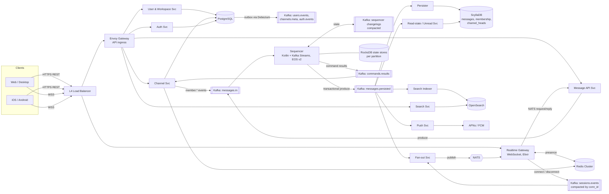

# xmsg: Architecture & Technology Plan

A Slack-style messenger built to hold **1,000,000 concurrent online users**.

**Scope for v1:** workspaces, public and private channels (Slack-style), DMs (1:1), group DMs, and broadcast channels (one-to-many, read-only for most members).
**Security model:** TLS in transit plus encryption at rest. No E2EE, so the server can search, sync and moderate.
**Deployment:** Kubernetes, cloud-agnostic, self-managed open-source stack.
**Out of v1, but the design leaves room for:** media and files, voice and video calls, bots and webhooks, multi-region.

---

## 1. Design targets (capacity assumptions)

| Metric | Target | Notes |
|---|---|---|
| Concurrent WebSocket connections | 1M (designed for 1.5M) | ~1.3 connections per user (multiple devices) |
| Registered users | ~10–20M | |
| Messages sent | 20k/s sustained, 100k/s peak | |
| Message deliveries (after fan-out) | 1–2M/s, 5M/s peak | Average ~50 online recipients per message |
| End-to-end delivery latency | p50 < 100 ms, p99 < 500 ms | Same region |
| Message history | Kept forever (configurable per workspace) | ~1.7B messages/day at 20k/s; at ~500 B per row ≈ 0.9 TB/day raw. ×3 replication, ÷~3 compression, plus OpenSearch and Kafka copies ≈ **2–3 TB/day of disk** |
| Availability | 99.95% | Multi-AZ within one region |
| Largest channel | 500k members | Broadcast channels use the "pull" fan-out path (§5.3) |

Every sizing number below comes from these targets. Re-check them after the first load tests.

---

## 2. High-level architecture



**Basic rule:** the HTTP request path handles reads and commands, Kafka is the durable record of every event, NATS gives low-latency delivery to gateways, and the gateways only hold sockets.

---

## 3. Technology choices (summary)

| Layer | Choice | Why | Alternatives |
|---|---|---|---|
| Realtime gateway | **Elixir** on the BEAM (Bandit/Cowboy WebSocket, Phoenix optional) | One lightweight process per connection; a crash affects only that connection; preemptive scheduler keeps latency even under load; proven at millions of connections (WhatsApp, Discord) | Go, Rust (tokio) |
| Sequencer | **Kotlin + Kafka Streams** (JDK 21, Generational ZGC) | Exactly-once processing, RocksDB state stores, changelogs, standby replicas and cooperative rebalancing are built in and battle-tested; Rust has no mature equivalent (§3.1) | Rust with a custom framework (+6–8 weeks, rejected in review #3) |
| Core services | **Rust** (tokio, axum, tonic) | No GC pauses (steady tail latency), small memory use per pod, strong type safety; team preference | Go |
| Push / search indexer / workers | **Rust** | Same toolchain and shared crates | |
| Web client | **TypeScript + React**, Vite, Zustand or Redux Toolkit, IndexedDB cache | | Svelte |
| Desktop client | **Tauri** (wraps the web app) | Much smaller than Electron | Electron |
| Mobile clients | **React Native** (shares the TS protocol/sync core with web) | One team covers all platforms | Native Swift + Kotlin if UX or perf requires it |
| Client↔server protocol | **WebSocket + Protobuf** frames; REST/JSON (or Connect-RPC) for non-realtime APIs | Binary, compact, versioned | MQTT |
| Service↔service | **gRPC** (tonic + prost) between Rust services; **NATS request/reply** from the Elixir gateway to services. Schemas in **Protobuf, managed with Buf** | Typed contracts, breaking-change checks in CI; NATS avoids the immature `elixir-grpc` path | |
| Event log | **Apache Kafka** (Strimzi operator, KRaft mode) | Durable, ordered per partition, replayable, transactions (needed by the sequencer) | **Redpanda** if the platform team is small: one binary, no JVM, same API including transactions |
| Realtime routing | **NATS** (core pub/sub + request/reply, NATS operator / Helm) | Sub-millisecond fan-out to gateways, millions of subjects. At-most-once, so gaps are repaired by sync (§4.1, §5.2) | Redis Pub/Sub (weaker at this scale) |
| Postgres → Kafka events | **Transactional outbox** + **Debezium** (Kafka Connect on Strimzi) | No dual writes: an event is published if and only if its Postgres transaction committed (§4.3) | Small Rust outbox relay |
| Messages store | **ScyllaDB** (Scylla Operator) | Wide-column, built for time-series writes; Discord uses it for the same workload | Cassandra |
| Relational data | **PostgreSQL** (CloudNativePG operator) + PgBouncer | Users, workspaces, channel metadata, devices, tokens: relational and transactional (membership lives in Scylla, §4.4) | CockroachDB / Citus if Postgres outgrows vertical scaling plus sharding |
| Cache / sessions / presence | **Redis Cluster** (or **Dragonfly**) | Fast, has TTL support, works for rate limiting | KeyDB |
| Search | **OpenSearch** | Full-text search, filtered by workspace/channel ACL | Elasticsearch, Meilisearch for smaller scale |
| Object storage (phase 2) | **S3 API** via MinIO / Ceph RGW (or cloud S3) + CDN | Presigned uploads, no file bytes through our services | |
| Analytics | **Deferred past v1.** Start with product analytics in Postgres or a SaaS tool | One fewer stateful system to run in v1 | ClickHouse once volume justifies it |
| Ingress / API gateway | **Envoy Gateway** (Gateway API) for HTTP APIs only | HTTP/2, rate-limit filter, JWT validation for REST | Traefik, NGINX |
| L4 load balancing + WebSocket TLS | Cloud NLB with TLS listeners, or **HAProxy (TCP mode)** behind MetalLB + BGP on bare metal | WebSockets need L4 with long idle timeouts; TLS stays out of the BEAM (§4.1) | |
| Service mesh | **Linkerd** | mTLS between services, retries, lightweight | Istio (heavier) |
| Identity | Own **Auth Svc** (short-lived JWT + rotating refresh tokens); **Ory Kratos/Hydra** or **Keycloak** for SSO/OIDC/SAML later | | |
| Secrets | **External Secrets Operator** + **HashiCorp Vault** (or OpenBao) | Same setup on any cloud | SOPS for GitOps repo |
| Certificates | **cert-manager** + Let's Encrypt | | |
| CI | **GitHub Actions** | | GitLab CI |
| CD | **Argo CD** (GitOps) + **Argo Rollouts** (canaries) | | Flux |
| Packaging | **Helm** charts + Kustomize overlays | | |
| Infra-as-code | **Terraform / OpenTofu** | Clusters, networks, DNS | Pulumi |
| Container registry | **Harbor** (or cloud registry) | Image scanning | |
| Observability | **OpenTelemetry** → **Prometheus** (+ **Thanos**/Mimir), **Grafana**, **Loki** (logs), **Tempo** (traces), **Alertmanager**, **Sentry** (client errors) | | VictoriaMetrics |
| Load testing | **k6** (HTTP) + custom **Rust WebSocket swarm** tool (tokio-tungstenite) (1M simulated clients) | k6 alone has trouble driving 1M sockets | Tsung |
| Chaos testing | **Chaos Mesh** | | Litmus |

### 3.1 Language split: Elixir gateway, Kotlin sequencer, Rust everywhere else

**Elixir: the gateway.** Its job is holding a million mostly idle sockets and routing small frames. BEAM's process-per-connection model, supervisors and fair scheduler were built for exactly this.

**Kotlin + Kafka Streams: the sequencer only.** The sequencer needs exactly-once transactions, an embedded RocksDB state store, changelogs with restore, standby replicas and cooperative rebalancing. Kafka Streams has all of this built in and proven in production; in Rust we'd have to write and debug that framework ourselves, and its bugs mostly show up under crashes and rebalances. The sequencer is small (a few thousand lines), so one JVM service is a much smaller cost than a home-grown stream processor. JVM pauses are kept sub-millisecond with **Generational ZGC** (JDK 21).

**Rust: all other core services and workers.** What it gives us:
- No garbage collector, so tail latency stays flat. This matters most in `fanout` (1–5M deliveries per second).
- Low memory and CPU per pod, so fewer nodes for the same load.
- Strong types and `Result`-based error handling catch many bugs at compile time.

**What it costs, and how we limit it:**
- **Slower development and compile times.** Use a single Cargo workspace with shared crates, `sccache` in CI, and `cargo-chef` for Docker layer caching.
- **Async complexity.** Set team conventions: `tokio` only, `axum` + `tonic` for every service, `anyhow` in binaries and `thiserror` in libraries, no custom executors.
- **A harder hiring pool.** Keep business logic in plain, simple Rust; save advanced patterns for the hot paths.

**Crates for this stack:**

| Need | Crate |
|---|---|
| Async runtime | `tokio` |
| HTTP API | `axum` + `tower` (middleware: auth, rate limits, timeouts) |
| gRPC + Protobuf | `tonic` + `prost` (code generated with Buf) |
| Kafka | `rdkafka` (librdkafka bindings, the most mature option) |
| PostgreSQL | `sqlx` (compile-time checked queries) |
| ScyllaDB | `scylla` (official ScyllaDB driver) |
| Redis | `fred` (cluster-aware, pipelining) |
| NATS | `async-nats` |
| OpenSearch | `opensearch` |
| Push | `a2` (APNs), `reqwest` for the FCM HTTP v1 API |
| Auth tokens | `jsonwebtoken`, `argon2` |
| Observability | `tracing` + `tracing-opentelemetry`, `metrics` + Prometheus exporter |
| Config | `figment` or `config` |
| Testing | `testcontainers`, `tokio::test`, `insta` (snapshots) |

---

## 4. Services in detail

### 4.1 Realtime Gateway (`gateway`), Elixir
- **Stack:** Elixir/OTP 27+, **Bandit** (or Cowboy) WebSocket handlers. Phoenix Channels are optional; our Protobuf frame protocol can be served from a raw `WebSock` handler. Libraries: `protobuf` (elixir-protobuf), `gnat` (NATS, for both delivery and **request/reply calls into Rust services**), `redix` (Redis), `brod` (Kafka producer for `sessions.events`), `opentelemetry_*`, `telemetry` + PromEx for metrics. We use NATS request/reply instead of `elixir-grpc` because the gateway already holds a NATS connection, queue groups give load balancing and failover for free, and it avoids the least proven library in the stack.
- **One BEAM process per connection**, under a `DynamicSupervisor`. A crash in one connection's handler only drops that client, and the client reconnects.
- **TLS is terminated before the gateway**, at the L4 load balancer (cloud NLB TLS listener) or at HAProxy in TCP mode on dedicated edge nodes. Doing TLS for 1.5M sessions in the BEAM's `:ssl` would add ~20–40 KB per connection and a lot of CPU during handshake storms. Each pod holds **~100k** connections.
  - 1.5M connections ÷ 100k per pod ≈ **15 pods**, plus headroom → run **~20** (8 vCPU / 16 GB each).
  - Memory budget: about 30–60 KB per connection (process heap plus socket buffers). **Hibernate** idle connection processes (`:hibernate` after ~15 s of no traffic) to shrink their heaps.
  - BEAM tuning: raise `+P` (max processes, e.g. 5M) and `+Q` (max ports); make sure scheduler count matches the container CPU limit (OTP 25+ reads cgroup quotas); run `+sbwt none` to stop busy-waiting schedulers from wasting CPU.
  - Kernel tuning: `ulimit -n` 1M, `net.ipv4.ip_local_port_range`, `somaxconn`, `tcp_tw_reuse`, conntrack limits.
- **No distributed Erlang clustering needed.** NATS does cross-node routing, `sessions.events` records sessions and Redis holds presence, so each pod is independent and easy to scale. (libcluster + Phoenix.PubSub stays available if we later want in-cluster features.)
- Inside a pod, a local `Registry` maps `user_id → connection pids`. When a NATS batch for `gw.{gateway_id}` arrives, the gateway sends each frame directly to the right processes.
- Responsibilities:
  - **Connect handshake:** the first frame carries the JWT (never in the URL) and a `protocol_version`. The gateway rejects versions below a server-controlled minimum with an "upgrade required" error, which gives us a kill switch for broken clients.
  - Publish `session.connected` / `session.disconnected` and **`session.app_state`** (foreground/background, reported by the client) to Kafka `sessions.events`, a **compacted topic keyed by `conn_id`** (a tombstone on disconnect), used by fan-out (§4.7) and push (§4.10). There is no separate Redis session registry; this topic is the source of truth.
  - Publish a liveness heartbeat `gateway.alive.{gateway_id}` on NATS every 2 s (§4.7). When the gateway's NATS connection comes back after a drop, it **republishes `session.connected`** for all its live connections, in case fan-out dropped them.
  - Subscribe to NATS subjects: `gw.{gateway_id}` (direct delivery), `ch.{channel_id}` for large channels its users belong to (§5.3), `auth.revocations`, and `presence.{user_id}` for users its clients are watching (**refcounted**: one subscription per watched user per gateway, released ~30 s after the last local viewer stops watching, so scrolling doesn't churn NATS).
  - Publish typing indicators to NATS `typing.{partition}` (using the shared `partition(channel_id)` function, §4.6), where the owning fan-out instance delivers them (§4.8).
  - Forward client commands (send message, mark read, typing) to backend services over **NATS request/reply** (queue groups per service, with deadlines).
  - Heartbeat: ping every 30 s, drop the connection after 2 missed pings.
  - Issues a short-lived **resume token** on connect, so reconnects after a network blip skip full authentication (§10.4).
  - Backpressure: a bounded send queue per connection; slow consumers get dropped and resync on reconnect.
- **Token expiry and revocation on open sockets:**
  - The gateway tracks each connection's token expiry and asks the client to send a fresh access token in-band ~2 minutes before it expires. No refresh before expiry means disconnect.
  - On `session.revoked`, `user.banned` or `workspace.member_removed` events (from the `auth.revocations` subject), the gateway closes the matching connections (all of them, or those for that workspace) right away. Channel removals don't come this way: they arrive through the pipeline as `member.left` (on `ch.{id}` for pull-mode channels, where the gateway drops the user from its index; for push-mode channels fan-out simply stops delivering).
- **Delivery gaps (NATS is at-most-once), detected by the gateway, not by client polling:**
  - Every batch fan-out sends to `gw.{gateway_id}` carries a **stream ID `(partition, owner_epoch)` and a sequence**. The gateway tracks the last sequence per stream. A new `owner_epoch` (fan-out rebalance) resets tracking instead of counting as a gap.
  - Fan-out also sends `stream_heads` every 1 s (§4.7). If it shows a higher sequence than the gateway received, the last batch was lost, so quiet streams are covered too.
  - On a gap, the gateway sends a **partition-scoped `resync` hint** (`resync{partition}`) to its clients. Each client computes `partition(channel_id)` for its own channels (§4.6) and syncs only those, about 1/512 of its channels and usually 0–2. One dropped NATS message no longer means 100k full syncs.
  - On `ch.{channel_id}` subjects (large channels), the channel's `event_seq` is the sequence, so gaps are detected per channel and only that channel is resynced.
  - When the NATS connection drops and comes back, or NATS flags a slow consumer, the gateway sends `resync` to all its clients.
  - Clients run the cheap sync (§5.2) on `resync`, on reconnect and on app foreground. Background polling is rare (every 30 min) and covers only the open channel and channels with unread mentions. Polling every client every few minutes would cost ~2.8M Redis reads per second at 1M users.
- **Unauthenticated sockets** are closed if no valid auth frame arrives within 5 s, and pre-auth connections are capped per IP.
- **Per-connection command limits** (e.g. sends/s, typing/s, syncs/min), enforced in the gateway, since Envoy's rate limiting doesn't see WebSocket frames.
- **Admission control:** a token bucket on new sessions per pod (e.g. 2k/s). Connections over the limit are told to retry after a jittered delay, so a mass reconnect can't overload the sync path.
- **Graceful drain on deploy:** stop accepting connections, tell clients to reconnect with jitter over about 5 minutes, so a rolling deploy doesn't cause a reconnect storm.
- Stateless apart from sockets: losing a pod costs only reconnects.

### 4.2 Auth Service (`auth`), Rust + PostgreSQL
- Signup, login (email+password with argon2id, magic link, OAuth via Google/GitHub), device sessions.
- Issues **access JWTs (15 min, Ed25519-signed)** and **rotating refresh tokens** (stored hashed, revocable).
- Public keys at a JWKS endpoint so services validate tokens locally without calling auth. **Envoy validates JWTs for HTTP APIs; the gateway validates them for WebSockets** (in the first frame, since Envoy isn't in the socket path).
- Publishes revocations (`session.revoked`, `user.banned`, `workspace.member_removed`) through the Postgres **outbox** (§4.3) to Kafka `auth.events`, and a small relay forwards them to the NATS `auth.revocations` subject. They're **also published directly to NATS right after the commit** (fast path, §4.4), so open sockets close within about a second; the outbox path is the safety net.
- Later: SSO (SAML/OIDC) per workspace through Ory or Keycloak, SCIM provisioning.

### 4.3 User & Workspace Service (`users`), Rust + PostgreSQL
- Users, profiles, workspaces, workspace membership, roles (owner, admin, member, guest), invites.
- Profile cache in Redis, with cache invalidation events published to Kafka (`users.events`).
- **Removing a user from a workspace** (or deactivating them) touches every channel they're in, each on a different partition, so it can't be one atomic event. It happens in two steps:
  1. **Cut access first:** `users` commits the removal plus an outbox event and sends `workspace.member_removed` fast-path to `auth.revocations`. Gateways close the user's connections for that workspace, and `auth` stops issuing tokens for it. Delivery stops within seconds.
  2. **Then clean up:** a background job reads the user's `channels_by_user` rows for that workspace and sends one `member.kick_requested` command per channel, at a controlled rate. The commands are idempotent, so the job can safely be retried.
  
  Read paths (history, search) check **workspace membership** as well as channel membership, so the user can't read anything while step 2 is still running.
- **Transactional outbox (all Postgres-backed services: `auth`, `users`, `channels`):** every state change writes its event to an `outbox` table **in the same Postgres transaction**. **Debezium** reads the outbox through logical replication and publishes it to Kafka. A change is published if and only if it committed, so caches, search and gateways can't silently drift.
- **Outbox safety across Postgres failover:** logical replication slots used to live only on the primary, so a failover could make Debezium skip events. To prevent that:
  - run **PostgreSQL 17+ with failover slots** (slot created with `failover = true`, `sync_replication_slots = on` on standbys), so the new primary keeps Debezium's position. Confirm in Phase 0 that the CloudNativePG version we run supports this for logical slots;
  - keep outbox rows for **7 days** (removed by a cleanup job, not on publish);
  - after any failover, an **outbox reconciler** compares outbox rows with what reached Kafka (by outbox event ID) and republishes any gaps. Every outbox consumer is idempotent by event ID, so republishing is safe.

### 4.4 Channel Service (`channels`), Rust + PostgreSQL + ScyllaDB + Redis
- Conversation types: `public_channel`, `private_channel`, `dm`, `group_dm`, `broadcast`.
- Channel metadata (name, topic, type, archive state, pinned items) lives in **PostgreSQL**. Changes go out through the outbox (§4.3). Changes clients must see in order (`channel.updated`, `channel.archived`, public ↔ private) are copied from `channels.meta` into `messages.in` by a small **`meta-relay`** consumer, so they get an `event_seq`. The sequencer dedupes them by outbox event ID. A CDC replay after a long outage can fall outside the 15-minute dedupe window, but metadata events carry absolute values, so applying one twice is harmless.
- **Creating a channel or DM (fast path + outbox safety net):**
  - `channels` writes the Postgres row (and `dm_pairs` for a DM) plus an outbox event **`channel.created{channel_id, type, initial_members}`** in one transaction. Initial members are the creator, the DM pair, or the group DM members.
  - Right after the commit, `channels` **also produces the same event directly to `messages.in`**, with the same outbox event ID. This fast path takes a few ms, instead of the ~0.1–2 s of CDC lag through Debezium.
  - Debezium → `meta-relay` delivers it again later as the safety net. The sequencer **dedupes by outbox event ID**, and `channel.created` is a no-op if the channel already exists, so a late or replayed copy is harmless even outside the 15-minute dedupe window.
  - The sequencer creates the channel's state and its initial memberships **atomically in one event**, so a first message can never arrive before its members exist.
  - The same fast-path-plus-outbox pattern is used for other interactive metadata changes (rename, topic, archive) and for revocations (§4.2).
- **Membership lives in ScyllaDB** (`members_by_channel` + `channels_by_user`). At 10–20M users with 50–200 channels each, that's 1–4 billion rows with steady writes, which Scylla handles better than a single Postgres primary. Both read patterns fan-out needs ("who is in this channel", "which channels is this user in") are single-partition reads.
- **Membership changes go through the channel's own pipeline, as commands the sequencer validates.** `channels` only does stateless checks (authentication, input format), then produces a command (`member.join_requested`, `member.invite_requested`, `member.kick_requested`, `member.role_change_requested`) with a request ID to `messages.in`, keyed by channel. The **sequencer** validates it against its authoritative membership state (the actor is a member with permission, the channel isn't archived, it's under the member limit) and emits `member.joined` / `member.left` / `member.role_changed` or a rejection. `channels` waits for the outcome on `commands.results` (a few ms) and returns it to the caller. The topic is small, so **every `channels` instance reads all of it** (`read_committed`) and ignores request IDs it isn't waiting for. Requests time out after 2 s with a "pending" answer; the client then sees the result arrive as a normal channel event. Concurrent kicks, invites from just-removed members and member-limit races are therefore decided in one place, in channel order. `channels` does **not** write Scylla itself; the **persister** writes both membership tables (§4.6). So:
  - membership changes are ordered with messages: nothing sequenced after a removal reaches the removed member, and a new member gets everything from their join onward;
  - a change can't be half-applied (Scylla updated but caches not told, or the reverse), because there is only one write path;
  - fan-out and gateways learn about changes from the same `messages.persisted` stream they already read.
- A client that just joined sees the channel when its own `member.joined` arrives over the socket, a few ms later.
- Per-member roles (who may post in broadcast channels), mute and notification settings are stored on the membership row. Personal settings (mute, notify level) don't affect delivery order, so they're written directly by `channels` and published through the outbox.
- `members:{channel_id}` in Redis is a cache filled by the persister. `channels.membership` is now a **derived, compacted feed** (produced from `messages.persisted`) for systems outside the pipeline, such as the search ACL cache.
- DM uniqueness: DMs get a normal Snowflake ID, plus a unique row in Postgres `dm_pairs(user_low, user_high) → channel_id`. (A derived ID would leak who is talking to whom in logs and URLs, and wouldn't work for group DMs.)

### 4.5 Message API Service (`messages`), Rust
- **Write path:** early, best-effort checks (membership from a Redis/LRU cache, permissions, rate limits, size, `@channel` rules from §5.3; the sequencer makes the final membership check, §4.6) → attach a `client_msg_id` (idempotency key from the client) → produce to Kafka `messages.in`, **keyed by `channel_id`** (`acks=all`, idempotent producer) → return `accepted` to the sender.
- **Read path:** history pagination by `msg_seq` (`before/after`), thread replies from `thread_messages` (§5.4), single-message fetch, all from ScyllaDB.
- **Every change is a channel event:** `message.created`, `message.edited`, `message.deleted`, `reaction.added/removed`, `thread.reply`, `pin.added`, `member.joined/left/role_changed`, `channel.updated`. All of them go through the same pipeline and get an `event_seq` (§4.6).
- Edits, deletes and reactions carry the target's `msg_seq` (or `thread_root` + `reply_seq`) as well as its `message_id`, so the persister can update the row by its primary key without a lookup.
- **Reaction batching:** `messages` combines reactions per `(channel, message, emoji)` over a **1-second window** and produces one `reactions.batch{adds, removes}` event, so a popular post costs one `event_seq` per second per emoji instead of one per reaction. Pull-mode channels also have a per-channel rate limit on reaction events; the excess waits in the next batch.
- **Edit and delete authorization:** only the author may edit; the author or a channel admin may delete. `messages` reads the target row at `LOCAL_QUORUM` to check the author. If the row isn't there yet but its `msg_seq` is at or below the channel head (it was just sent and the persister hasn't caught up), it retries for up to ~200 ms before rejecting. **Admin deletes** of other people's messages are sent as commands, like membership changes, and the sequencer checks the admin role in its `members` store.
- **Sync API:** two-step and cheap by default (§5.2).

### 4.6 Sequencer (`sequencer`, Kotlin + Kafka Streams) and Persister (`persister`, Rust)
Ordering and durability are split into two services so that **Kafka is the single source of truth** and old partition owners are fenced off.

**Sequencer:**
- A **Kafka Streams** application (Kotlin, Processor API) reading `messages.in`. Each stream task owns one partition, so **each channel has a single writer**.
- **`processing.guarantee = exactly_once_v2`** (the KIP-447 model): one transactional producer per stream thread; output, state changelog writes and input offsets commit in one transaction. If a task moves during a rebalance, the old owner's late commit is fenced by the broker. Two owners can never both publish the same `seq`.
- **`commit.interval.ms` = 5–10** (Kafka Streams' EOS default of 100 ms is far too slow here). Fan-out reads with `read_committed`, so this interval is added directly to delivery latency. Producer `linger.ms` is 0–1 ms.
- **Rebalances:** Kafka Streams' cooperative rebalancing with **static membership** (`group.instance.id`), so a rolling restart doesn't trigger rebalances at all, and warm-up replicas (KIP-441) so tasks only move once their new owner has caught up.
- Assigns **two per-channel counters**:
  - **`event_seq`**: increases on *every* channel event. Clients use it to detect gaps and to sync.
  - **`msg_seq`**: increases only on new top-level messages (and thread replies sent "also to channel"). Used for history pagination and unread counts.
- **Enforces membership:** the sequencer applies membership changes to its state as it sequences them, and rejects (with a `message.rejected` event back to the sender) posts from users who aren't members at that point in the channel's order. This is the authoritative check.
- **Validates membership commands (§4.4):** `channels` sends `member.join_requested`, `member.invite_requested`, `member.kick_requested` and `member.role_change_requested` commands. The sequencer checks them against its authoritative state (the actor is a member with permission, the channel isn't archived, it's under the member limit) and emits either the resulting `member.joined` / `member.left` / `member.role_changed` event or a rejection. The outcome also goes to the small `commands.results` topic, keyed by request ID, so `channels` can answer the caller.
- **Channel creation:** `channel.created{initial_members}` creates the channel's state and initial memberships in one event. Posts and commands for a channel the sequencer doesn't know yet are rejected. Duplicate `channel.created` events (fast path plus outbox, §4.4) are deduped by outbox event ID and are a no-op once the channel exists.
- **Delivery mode:** the sequencer decides each channel's fan-out mode (`push` or `pull`, §5.3) from its member count, with **hysteresis**: switch to pull when the channel reaches 1,000 members, and back to push only when it drops below 800, so a channel near the line doesn't flap. A switch is emitted as an ordered **`channel.mode_changed{mode}`** event, and every event carries the channel's current mode, so all consumers switch at the same point in the channel's order.
- **Membership version:** every event carries the channel's **`membership_version`** (the `event_seq` of its latest membership change), so consumers can tell whether a membership snapshot is new enough (§4.7).
- **State stores** (RocksDB, managed by Kafka Streams, each backed by a compacted **changelog topic** written in the same transaction as the output):
  - **`channel_heads` store:** per channel `event_seq`, `msg_seq`, `last_mention_seq`, `membership_version`, `fanout_mode`, member count; plus one per-partition key with the last issued `message_id`.
  - **`members` store:** one key per membership, `(channel_id, user_id) → role`. Point lookups per message, never set blobs.
  - **`threads` store:** keyed by `(channel_id, thread_root)`: `reply_seq` and `reply_count`.
  - **`reaction_counts` store:** keyed by `(channel_id, message_id, emoji)`: the current count, so each `reactions.batch` event carries absolute counts and the persister sets them (never increments).
  - **`dedupe` store:** a **windowed store** of `client_msg_id`s from the last **15 minutes** (§10.2 has the matching client retry limit).

  RocksDB keeps hot data in its block cache and the rest on local NVMe, so memory stays bounded as threads pile up. On task assignment, stores are restored from their changelogs, **never from Scylla**, because Scylla may lag behind the sequencer.
- **Sizing:** the `members` store is a second full copy of membership: **1–4B entries**, about 2–8M per partition, roughly 100 bytes each → **~0.2–0.8 GB per partition on disk** and **~100–400 GB of changelog** (×3 replication on Kafka disks, after compaction). Restore and standby catch-up times for this are part of the Phase 0 test. For the first production deployment, the `members` changelog is bootstrapped once from Scylla, offline, before traffic.
- **Standby replicas:** `num.standby.replicas = 1`, so each task has a warm copy on another instance and a crash hands over in seconds instead of replaying the changelog.
- **Membership snapshot endpoint:** a small gRPC endpoint on each sequencer instance serves a channel's membership from its `members` store, using **Kafka Streams Interactive Queries** (routed to the instance that owns the channel's partition). That store is always at least as new as anything downstream has seen, so it's the fallback when Scylla is behind (§4.7).
- **Testing:** `TopologyTestDriver` for unit tests of every rule (ordering, dedupe, membership, threads), plus Testcontainers Kafka for EOS and rebalance tests.
- Produces the sequenced event to `messages.persisted` and commits input offsets and state changes, all in one transaction.
- **Message IDs** are Snowflake-style and **assigned by the sequencer**: `message_id = (ms timestamp, partition [9 bits], counter)`. The partition is a natural, stable "node" ID, since only one owner writes it at a time (fenced by EOS). The last issued ID per partition is kept in the `channel_heads` store (under a per-partition key), and a new owner continues from `max(last_id + 1, now)`. That handles clock skew between machines and IDs from cancelled transactions, which were never visible. IDs are unique across the system and used as stable references (edits, reactions, links); `event_seq` / `msg_seq` handle ordering.

**Persister:**
- A plain consumer of `messages.persisted` that writes to ScyllaDB.
- All writes are **idempotent upserts** keyed by `(channel_id, bucket, msg_seq)` or the event's natural key, so replays after a crash or rebalance are harmless. Values that change over time (`reply_count`, heads) are **set to the absolute value carried in the event**, never incremented.
- Writes membership tables from `member.*` events (§4.4), then records the applied `membership_version` in `channel_heads`, so readers can tell how fresh the membership tables are (§4.7). **Order matters:** the rows live in different partitions, and a Scylla batch doesn't make them visible together, so the persister writes the membership rows first, waits for them, and only then writes the version. All of these writes, and every membership snapshot read, use **`LOCAL_QUORUM`**, so a reader that sees version X also sees the rows for X.
- After writing membership rows, the persister also produces the **derived `channels.membership` feed** (§4.4).
- Writes **`channel_heads`** in Scylla (the durable source of truth for `event_seq`, `msg_seq`, `last_mention_seq`), then updates the `chan_head:{channel_id}` cache in Redis with a Lua script that only ever **raises** each value, so replays, reordered writes and failovers can't move a head backwards. On a Redis miss or loss, heads are read back from `channel_heads`.
- Fan-out reads from `messages.persisted` in parallel, so a message can reach recipients a few ms before it's in Scylla. Clients that immediately fetch history may not see it yet; they merge in what they already have from the socket.

**Partitioning rule:** `messages.in` and `messages.persisted` are created with their **final partition count (512) and are never resized**. Adding partitions would move channels to new partitions and break ordering and sequencer state. Throughput alone would need only ~10–50 partitions (100 MB/s peak at ~10 MB/s per partition), so 512 gives large growth headroom and allows up to 512 parallel consumers and stream tasks, while keeping broker and transaction overhead low. If we ever outgrow it, we migrate to a new topic pair with a planned cut-over.

**One partition function everywhere:** `partition(channel_id) = toPositive(murmur2(key)) % 512`, where `key` is the 8-byte big-endian `channel_id`. This is exactly Kafka's default partitioner, so it matches what Kafka Streams uses. It's specified once in `proto/` and implemented or configured in **Rust** (producers and fan-out), **Kotlin** (the sequencer, via Kafka's default partitioner), **Elixir** (gateway typing and resync) and **TypeScript** (clients, for partition-scoped resync). All four are checked against a shared **test-vector file in CI**. Rust producers use librdkafka's Java-compatible **`partitioner = murmur2_random`** setting (librdkafka's own default, `consistent_random`, differs).

### 4.7 Fan-out Service (`fanout`), Rust
- Consumes `messages.persisted`, which includes `member.*` events in channel order, plus read-state events that need delivery to a user's other devices. Typing and read receipts arrive over NATS, not Kafka (§4.8, §4.9).
- **Small and medium conversations (≤ ~1,000 members), push model:** look up members, then their online sessions, group by gateway, and publish one batch per gateway to `gw.{gateway_id}`.
- **Lookups come from memory, not Redis.** Each fan-out instance keeps:
  - a **per-connection** map (`conn_id → user_id, gateway_id`, indexed by user) built from `sessions.events`. The topic is compacted by `conn_id`, so on startup a replay gives exactly the current connections. Entries are added and removed per `conn_id`, so events from different gateways arriving in any order can't remove a live connection. When a gateway misses ~3 heartbeats (`gateway.alive.{id}`, §4.1), it's marked **suspect** but delivery continues (sending to a dead subject only wastes NATS messages). Its entries are dropped only after **~60 s** without heartbeats, so a NATS blip can't cut off 100k live users. A **janitor** job tombstones the `conn_id`s of gateways that are really gone, so the compacted topic doesn't keep dead entries;
  - channel membership for the active channels on its partitions, updated by the `member.*` events in the same `messages.persisted` partition, so membership is always applied in order with messages. Inactive channels are evicted (LRU) and reloaded from Scylla on the next event.
  - **Snapshot rule:** the persister can lag behind fan-out, so a Scylla snapshot may be older than the stream. Every event carries the channel's `membership_version` (§4.6), and the persister stores the version it has applied in `channel_heads`. Fan-out uses a Scylla snapshot only if its `membership_version` ≥ the event's (the common case). If Scylla is behind, fan-out loads the snapshot from the **sequencer's membership endpoint** (§4.6) instead, which is always new enough. Only if both are unavailable does it hold that channel's deliveries rather than guess, so a removed member can never get a message from a stale list, and a lagging persister doesn't stall delivery. Persister lag is alerted on, because it's partly on the delivery path.

  This removes ~1M Redis lookups per second at target load and a network hop from delivery. Cold starts rebuild sessions from `sessions.events` and membership from Scylla (with the snapshot rule below).
- **Membership is re-checked on every delivery** against that ordered state, so a removed member receives nothing sequenced after their `member.left`.
- Each batch to `gw.{gateway_id}` carries a stream ID `(partition, owner_epoch)` and a sequence, so the gateway can detect lost batches (§4.1). `owner_epoch` changes whenever the partition gets a new owner.
- **Stream heartbeats:** every 1 s each fan-out instance sends every gateway one small `stream_heads` message with the last sequence of each of its streams, so a lost *last* batch on a quiet stream is detected within ~1 s.
- **Large channels and broadcast (pull mode, decided by the sequencer, §4.6):** publish once to `ch.{channel_id}`. Gateways that have at least one interested user subscribe and fan out locally. Users who aren't viewing the channel get a lightweight "unread bump" instead of the full message.
- **Mode switches:** on `channel.mode_changed`, fan-out publishes the channel's events on **both** paths (`gw.*` batches and `ch.{id}`) for an **overlap window of ~10 s**, then only on the new path. Gateways switch subscriptions when they see the event and **drop duplicates by `event_seq`**, which they already track per channel. No message is lost while gateways subscribe or unsubscribe.
- Scales horizontally with Kafka partitions.

### 4.8 Presence & Typing (`presence`), Rust + Redis + NATS
- Online, away and offline state is derived from gateway sessions plus client activity pings. It's stored in Redis with TTLs.
- **Presence is lazy:** users only get presence updates for people visible on their screen (the DM list, the open channel's member list). They subscribe and unsubscribe through the gateway. Pushing every presence change to every contact doesn't work at 1M users.
- **Presence subscriptions are refcounted per gateway** (§4.1): one NATS subscription per watched user per gateway, however many local viewers.
- **Typing indicators** are ephemeral, never persisted and throttled to 1 per 3 s. The gateway publishes them to NATS `typing.{partition}`, and the fan-out instance that owns that channel partition delivers them using its in-memory membership. If anything is slow, they're dropped.

### 4.9 Read-state & Unread Service (`readstate`), Rust + ScyllaDB + Redis
- Stores `last_read_msg_seq` per `(user, channel)`. Unread count = `chan_head.msg_seq − last_read_msg_seq`, so no per-message counters are needed. Edits, reactions and thread replies don't count, because they don't take a `msg_seq` (§4.6).
- **New members:** on `member.joined`, `last_read_msg_seq` is set to the channel's `msg_seq` at that point, so history from before the join isn't counted as unread.
- **Own messages don't count as unread:** sending a message moves the sender's `last_read_msg_seq` to that message.
- **Read positions only move forward:** devices can mark-read out of order, and sends also move the position. All read-position updates (mark-read from any device, the sender's own sends, mark-unread) go through Kafka `readstate.events`, **keyed by `user_id`**, so each user has a **single writer**: the `readstate` instance that owns that partition. It merges mark-read and send updates with **max**, then writes Scylla. No LWT is needed, and a late "read up to 40" from the phone can't undo the desktop's "read up to 55".
- **"Mark as unread"** (a Slack feature) is an explicit operation in the same per-user stream that sets a lower position on purpose. Because one writer applies updates in order, a later real read simply moves the position forward again.
- **Direct `@user` mentions are stored as rows**, `user_mentions(user_id, channel_id, msg_seq)`, written idempotently, and the count is the number of rows after `last_read_msg_seq`, computed like `channel_mentions`. There's no counter to increment, so replays can't double-count and reads and mark-unread need no reset logic. A per-user, per-channel `last_mention_seq` lets sync skip the count when there's nothing new.
- **`@channel` / `@here` are counted at read time:** each one is stored once in `channel_mentions`. A user's badge = their own mention count + the number of `channel_mentions` rows after their `last_read_msg_seq`. A mention in a 500k-member channel costs one write instead of 500k. `chan_head.last_mention_seq` lets sync skip this lookup for channels with no new channel-wide mentions (§10.5).
- Thread unread state is tracked separately in `thread_read_state` (§5.4).
- **Read receipts ("seen by") only in DMs and group DMs.** Channels show unread counts only, like Slack. Receipts are routed like typing: `readstate` publishes `receipt{channel_id, user_id, msg_seq}` to NATS `receipts.{partition}`, and the fan-out instance that owns that partition delivers it to the other members. They're coalesced to at most 1 per user per channel per second and never take an `event_seq`. They're ephemeral: current read positions also come back in sync (§5.2), so a dropped receipt fixes itself.
- Syncs read position across a user's devices (reading on desktop clears the badge on mobile).

### 4.10 Push Notification Service (`push`), Rust
- Consumes `messages.persisted` and `sessions.events` (connections plus their foreground/background `app_state`). Notifies a user only if they have no connection in the foreground, haven't muted the channel, and the message matches their notification rules (all messages, mentions only, DM only).
- Sends to **APNs** (HTTP/2) and **FCM**, with a token registry in PostgreSQL. Collapses bursts into one notification per channel.
- **Who to notify without scanning every member:** members with `notify_level = all` are kept in a separate `push_subscribers(channel_id, user_id)` index, maintained by the persister from membership and settings events. For each post, `push` reads only that index, in chunks; mention-only users are found from the mention rows. A broadcast post no longer scans 500k membership rows.
- **Per-channel token bucket** on outgoing pushes, so an `@channel` in a large channel is spread out over time instead of sending hundreds of thousands of pushes at once. Thread replies go to thread followers only (§5.4).
- Handles invalid tokens, retries with backoff, and a dead-letter topic.

### 4.11 Search (`search` + `search-indexer`), Rust + OpenSearch
- The indexer consumes `messages.persisted` and edit/delete events and bulk-indexes into OpenSearch, using **one index per time period (monthly)** with workspace routing.
- Documents carry `workspace_id`, `channel_id` and `is_private`.
- **ACL filter:** public channels in a workspace match with one clause (`workspace_id = X AND is_private = false`). Private channels, DMs and group DMs are matched against a **cached "searchable private channels" list per user**, refreshed from the derived `channels.membership` feed and capped at the 1,000 most recent. Beyond the cap, results are post-filtered.
- When a channel switches between public and private, the indexer runs an `update_by_query` on that channel's documents to update `is_private`.
- Every result is checked against permissions again before it's returned.
- Filters: `in:#channel`, `from:@user`, date ranges, `has:link`.

### 4.12 Supporting services
| Service | Purpose |
|---|---|
| `ratelimit` | Envoy global rate-limit service backed by Redis: per user, per IP, per workspace |
| `admin` | Moderation tools, user bans, workspace admin, audit log viewer |
| `audit` | Kafka consumer that writes security-relevant events (logins, permission changes, deletions) to append-only storage |
| `notifications-prefs` | Per-user and per-channel notification settings (can live inside `channels` at first) |
| `media` *(phase 2)* | Presigned S3 uploads, virus scan (ClamAV), thumbnail/transcode workers (libvips, ffmpeg), served through a CDN |
| `integrations` *(phase 3)* | Bots, incoming and outgoing webhooks, slash commands, OAuth apps |

---

## 5. Key flows

### 5.1 Sending a message
1. Client → gateway: `SendMessage{channel_id, client_msg_id, body}`.
2. Gateway → `messages` (NATS request/reply): permission check, then produce to `messages.in` (keyed by channel).
3. Sender gets `Ack{client_msg_id, status: accepted}`. The UI shows "sending ✓".
4. `sequencer` assigns `event_seq` and `msg_seq` and produces to `messages.persisted` in one Kafka transaction.
5. In parallel from `messages.persisted`:
   - `fanout` → NATS → gateways → recipients (including the sender's other devices). The sender's own copy carries the final `msg_seq`, and the UI shows "sent".
   - `persister` writes to Scylla and updates `chan_head`.
   - `push` handles offline users, `search-indexer` indexes, and `readstate` writes `user_mentions` rows.

Target: steps 1–5 in **< 100 ms p50**.

**Multi-device ordering:** if two of a user's devices (or two users) send at nearly the same time, each device first shows its own message at the bottom. When the sequenced events arrive, clients **re-sort by `msg_seq`**, so every device ends up with the same order.

### 5.2 Reconnect and sync
After an outage, 1M clients reconnect within minutes. Reading message gaps from Scylla for every channel of every user would mean tens of millions of reads, so sync is split into a cheap step and a lazy step.

1. Client reconnects with exponential backoff plus jitter. The gateway's admission control (§4.1) spreads out the load.
2. **Cheap step:** the client sends one **sync token** (an opaque encoding of the `event_seq` heads it last saw). The server compares it with `chan_head:{id}` in Redis for all the user's channels (from `channels_by_user`) and returns only:
   - which channels changed and their new `event_seq` / `msg_seq` heads,
   - unread and mention counts from `readstate`,
   - a new sync token.

   No message bodies, and no Scylla message reads.
3. **Lazy step:** message bodies are fetched only for the open channel, and optionally the 5 most recently active ones. For those, the client asks for `channel_events` after its last `event_seq`. New messages and replies come back as pointers, and the server fills in their bodies with one `messages` range read by `msg_seq` before replying. If the gap is too large (or older than the 30-day event log), it reloads the latest page instead and marks the history gap.
4. Every other channel loads when the user opens it.
5. The client keeps a local cache (IndexedDB on web, SQLite on mobile), so the app opens instantly.

**Head rules:** clients always keep `max(local head, server head)` for each channel, and the same for read positions (the server's `read_state` can be a few ms behind the per-user writer, §4.9). If the server's head is *below* the client's (for example, the cache was rebuilt), that means "server is behind", and the client fetches `channel_events` directly instead of treating it as "no change".

**Large memberships:** for users in more than ~1,000 channels, the sync token becomes a server-side cursor instead of encoding every head, so it stays small.

The same cheap step runs on a `resync` hint from the gateway (only for the hinted partition's channels when the hint names one), on app foreground, and as a rare background check (§4.1).

### 5.3 Large and broadcast channels
- Push vs pull is decided per channel by the sequencer (1,000 / 800 members with hysteresis), and switches use a 10 s dual-publish overlap (§4.7).
- The push model would send 500k gateway messages for every post. Instead, the gateways subscribe to `ch.{id}` and fan out locally: ~20 NATS deliveries in place of 500k.
- **Gateway membership index:** for each large channel, a gateway keeps `channel → local user pids`. It only needs **its own users'** memberships, so when a user connects it reads that user's `channels_by_user` (one partition, which carries each channel's `fanout_mode`) to learn which pull-mode channels they're in, instead of reading a 500k-member list. To avoid a race between that snapshot and the live stream, the gateway subscribes to `ch.{id}` **first** and buffers, then reads the snapshot with its `membership_version`, then applies the buffered `member.*` events newer than that version. The gateway unsubscribes from `ch.{id}` when its last local member leaves.
- Members viewing the channel get the full event. Members not viewing it get a batched "channel updated" event (**at most 1 per channel every 5 s**), used for the unread dot.
- Posting permission is restricted to the `poster` role.
- **Reactions:** batched per second before sequencing (§4.5), so a viral post can't flood its partition. In pull-mode channels clients get **counts** per `(message, emoji)` plus their own reaction, not who reacted; the full "who reacted" list loads on demand from `reactions`.
- **`@channel` / `@here` rules:** turned off in broadcast channels. In other channels they're limited by role (admins and owners by default) and need a confirmation above 1,000 members. Each use costs one `channel_mentions` row, not one write per member (§4.9), and push sends for it are rate-limited per channel (§4.10).

### 5.4 Threads
- A reply goes through the normal pipeline as a `thread.reply` event on the parent channel's partition, so it's ordered with everything else in the channel.
- The sequencer gives it the channel's next **`event_seq`** and a per-thread **`reply_seq`**. It does **not** take a `msg_seq` (so it doesn't add to channel unread counts), unless the author chose "also send to channel".
- The persister writes it to `thread_messages` and updates the root's `reply_count` / `last_reply_at`.
- **Followers:** the root's author, everyone who replied, and anyone mentioned in the thread are added to `thread_followers`. Users can follow and unfollow by hand.
- **Delivery:** viewers of the channel get a small "thread updated" event (for the reply count). Followers get the full reply plus an unread mark in their Threads view. Pushes go to followers, following their notification settings.
- **Unread:** `thread_read_state` tracks the last read `reply_seq` per follower and thread.

---

## 6. Data model (core)

### PostgreSQL (relational, moderate volume)
```
users(id, email, password_hash, name, avatar_url, created_at, ...)
workspaces(id, name, slug, plan, settings_json, created_at)
workspace_members(workspace_id, user_id, role, joined_at)          PK(workspace_id, user_id)
channels(id, workspace_id, type, name, topic, is_archived, created_by, created_at)
dm_pairs(user_low, user_high, channel_id)                          PK(user_low, user_high)
devices(id, user_id, platform, push_token, last_seen_at)
refresh_tokens(id, user_id, device_id, token_hash, expires_at, revoked_at)
outbox(id, aggregate_type, aggregate_id, event_type, payload, created_at)   -- read by Debezium (§4.3)
```
Channel membership is **not** here; it lives in ScyllaDB (§4.4). Scale-out path for what remains: shard by `workspace_id` (Citus, or app-level sharding), since nearly every query is workspace-scoped.

### ScyllaDB (high volume)
All tables use **Incremental Compaction (ICS)**, or LCS for small read-heavy tables. TWCS is avoided because messages are kept forever and get edited and deleted, so updates and tombstones would land in old, never-recompacted windows. Deletes set `deleted = true` and clear the body; a periodic job hard-deletes rows for GDPR and retention.

```sql
-- Top-level channel messages. Partition by channel + msg_seq bucket so partitions stay bounded (< 100 MB).
CREATE TABLE messages (
  channel_id   bigint,
  bucket       int,        -- msg_seq / 10000
  msg_seq      bigint,
  event_seq    bigint,     -- event_seq at creation
  message_id   bigint,     -- snowflake
  author_id    bigint,
  body         text,
  attachments  frozen<list<attachment>>,
  reply_count  int,        -- thread summary, updated by persister
  last_reply_at timestamp,
  edited_at    timestamp,
  deleted      boolean,
  PRIMARY KEY ((channel_id, bucket), msg_seq)
) WITH CLUSTERING ORDER BY (msg_seq DESC);

-- Thread replies live apart from the channel timeline (§5.4).
CREATE TABLE thread_messages (
  channel_id  bigint,
  thread_root bigint,      -- message_id of the root
  reply_seq   bigint,      -- per-thread counter, assigned by the sequencer
  message_id  bigint,
  author_id   bigint,
  body        text,
  also_sent_to_channel boolean,
  edited_at   timestamp,
  deleted     boolean,
  PRIMARY KEY ((channel_id, thread_root), reply_seq)
);

CREATE TABLE thread_followers (
  channel_id bigint, thread_root bigint, user_id bigint,
  PRIMARY KEY ((channel_id, thread_root), user_id)
);

-- Durable channel heads (source of truth; Redis chan_head is a cache over this). Written by the persister.
CREATE TABLE channel_heads (
  channel_id bigint PRIMARY KEY,
  event_seq bigint, msg_seq bigint, last_mention_seq bigint,
  membership_version bigint,  -- event_seq of the latest member.* event applied to the membership tables
  fanout_mode text            -- push | pull (decided by the sequencer, §4.6)
);

-- Channel event log for sync. Short TTL; older gaps → reload.
-- message.created and thread.reply are stored as POINTERS only (msg_seq / reply_seq in payload), never with the body,
-- so message bodies aren't stored twice (~27 TB raw over 30 days). Small events (edits, reactions, pins,
-- member changes, channel updates) carry their full payload.
CREATE TABLE channel_events (
  channel_id bigint, bucket int,   -- event_seq / 10000
  event_seq bigint, type text, payload blob,
  PRIMARY KEY ((channel_id, bucket), event_seq)
) WITH default_time_to_live = 2592000;   -- 30 days

-- Membership (moved out of Postgres, see §4.4). Written as a pair by the persister from member.* events.
CREATE TABLE members_by_channel (
  channel_id bigint, user_id bigint, role text, notify_level text, muted boolean, joined_at timestamp,
  PRIMARY KEY (channel_id, user_id)
);
CREATE TABLE channels_by_user (
  user_id bigint, workspace_id bigint, channel_id bigint, channel_type text, fanout_mode text, joined_at timestamp,
  PRIMARY KEY (user_id, workspace_id, channel_id)
);

CREATE TABLE read_state (
  user_id bigint, channel_id bigint,
  last_read_msg_seq bigint,
  last_mention_seq bigint,  -- msg_seq of the latest direct @user mention, to skip counting when nothing is new
  PRIMARY KEY (user_id, channel_id)
);

-- Direct @user mentions as rows (no counters, so replays are harmless). Count = rows after last_read_msg_seq.
CREATE TABLE user_mentions (
  user_id bigint, channel_id bigint, msg_seq bigint,
  PRIMARY KEY ((user_id, channel_id), msg_seq)
) WITH CLUSTERING ORDER BY (msg_seq DESC);

CREATE TABLE thread_read_state (
  user_id bigint, channel_id bigint, thread_root bigint, last_read_reply_seq bigint,
  PRIMARY KEY (user_id, channel_id, thread_root)
);

-- Members who want a push for every message (notify_level = all). Maintained by the persister (§4.10).
CREATE TABLE push_subscribers (
  channel_id bigint, user_id bigint,
  PRIMARY KEY (channel_id, user_id)
);

-- One row per @channel/@here, so large-channel mentions cost one write, not one per member (§4.9).
CREATE TABLE channel_mentions (
  channel_id bigint, msg_seq bigint, kind text,   -- channel | here
  PRIMARY KEY (channel_id, msg_seq)
) WITH CLUSTERING ORDER BY (msg_seq DESC);

CREATE TABLE reactions (channel_id bigint, message_id bigint, emoji text, user_id bigint,
  PRIMARY KEY ((channel_id, message_id), emoji, user_id));

-- Reaction counts per message and emoji, set (not incremented) by the persister from the absolute counts
-- the sequencer carries in each reactions.batch event, so replays are harmless.
CREATE TABLE reaction_counts (channel_id bigint, message_id bigint, emoji text, count int,
  PRIMARY KEY ((channel_id, message_id), emoji));
```

### Redis
```
presence:{user_id}        string online|away  (TTL)
members:{channel_id}      set   user_ids (cache filled by persister; used for early checks in `messages`)
chan_head:{channel_id}    hash  event_seq, msg_seq, last_mention_seq (cache over Scylla channel_heads; raise-only Lua writes by persister; §4.6, §10.5)
rl:{scope}:{key}          rate-limit counters
```

### Kafka topics
| Topic | Key | Partitions | Retention |
|---|---|---|---|
| `messages.in` | channel_id | **512, never resized** | 3 days |
| `messages.persisted` | channel_id | **512, never resized** (co-partitioned with `messages.in`) | 7 days |
| Sequencer changelogs (`sequencer-channel_heads-changelog`, `-members-`, `-threads-`, `-dedupe-`) | per store key | 512 each (managed by Kafka Streams) | compacted (`dedupe`: windowed, 15 min). `members` is the big one: ~100–400 GB after compaction (§4.6) |
| `commands.results` | request_id | 16 | 1 hour |
| `sessions.events` | conn_id | 128 | compacted (tombstone on disconnect); includes `app_state` |
| `channels.membership` | channel_id | 64 | compacted; **derived**, produced by the persister after writing membership rows, for search and other consumers outside the pipeline |
| `users.events` | user_id | 64 | 7 days (from the outbox) |
| `channels.meta` | channel_id | 64 | 7 days (from the outbox) |
| `auth.events` | user_id | 32 | 7 days (from the outbox; revocations) |
| `readstate.events` | user_id | 128 | 1 day |
| `audit.events` | workspace_id | 32 | 30 days, then to object storage |

---

## 7. Security (TLS + encryption at rest)
- **In transit:** TLS 1.3 at the edge (WebSocket TLS ends at the L4 load balancer or HAProxy, HTTP TLS at Envoy), HSTS, and **Linkerd mTLS** between all pods, including the LB → gateway hop. Kafka, Redis, Postgres and Scylla use TLS on internal connections too.
- **Sessions:** short-lived access tokens, refreshed in-band on open sockets; revocations close sockets within seconds (§4.1, §4.2).
- **At rest:** encrypted volumes (cloud KMS-backed disks, or LUKS on bare metal), Scylla and Postgres backups encrypted with keys in Vault, and SSE on object storage.
- **AuthZ:** every message and channel operation checks membership. Search results are re-checked against ACLs before they're returned.
- **Abuse:** rate limits per user, IP and workspace; size limits on messages and frames; spam heuristics run as a Kafka consumer.
- **Compliance:** audit log, per-workspace data export, user deletion (GDPR) that tombstones messages in Scylla and removes them from search, and retention policies per workspace. GDPR and retention deletions are sent as rate-limited `message.deleted` commands through the pipeline (not only direct Scylla writes), so clients drop the messages from their local caches and search removes them through the normal path. Kafka `messages.in` / `messages.persisted` keep bodies for up to 7 days, so the deletion policy states that erasure completes within 7 days (Scylla, OpenSearch, Kafka, and client caches on next sync).
- **Socket hardening:** 5 s auth timeout, pre-auth connection caps per IP, per-connection command limits (§4.1).
- **Supply chain:** image scanning in Harbor/Trivy, signed images (cosign), SBOMs, Dependabot/Renovate.

---

## 8. Infrastructure layout (Kubernetes)

**One region, 3 availability zones** for v1. Every stateful system spans 3 AZs with replication factor 3.

| Node pool | Workloads | Approx. size (v1 at full load) |
|---|---|---|
| `gateway` | Elixir realtime gateways (tuned kernel sysctls, high fd limits) | ~20 pods on ~10–20 × 8 vCPU / 16 GB |
| `services` | Stateless Rust services, autoscaled with HPA (or KEDA on Kafka lag) | ~20–40 nodes, 8 vCPU / 16 GB |
| `kafka` | Strimzi Kafka brokers | 6–9 brokers, NVMe, 16 vCPU / 64 GB; disk budget includes ~0.3–1.2 TB for sequencer changelogs (×3) |
| `sequencer` | Kotlin Kafka Streams instances (JDK 21, Generational ZGC), RocksDB on local NVMe, 1 standby per task | ~8–16 instances, 8 vCPU / 32 GB, 1–2 TB NVMe each |
| `scylla` | ScyllaDB | 6–9 nodes to start, NVMe, 16–32 vCPU / 128 GB |
| `postgres` | CloudNativePG primary + 2 replicas (+ PgBouncer) | 3 × 16 vCPU / 64 GB |
| `redis` | Redis Cluster | 6 primaries + 6 replicas |
| `nats` | NATS cluster | 3–5 nodes |
| `search` | OpenSearch | 3 masters + 6–9 data nodes |
| `observability` | Prometheus, Loki, Tempo, Grafana | 4–6 nodes |

Notes:
- Stateful systems run on **dedicated node pools with local NVMe**, using operators. Pick each operator by maturity and keep "managed service" as an escape hatch per component.
- **PodDisruptionBudgets** plus topology spread across AZs for everything.
- **Autoscaling:** HPA on CPU for APIs, **KEDA on Kafka consumer lag** for fan-out, push and indexer, and gateways scaled on connection count (a custom metric).
- **Backups:** Scylla Manager snapshots, CloudNativePG WAL archiving to object storage, Kafka MirrorMaker 2 to a DR cluster (phase 3).
- **Recovery targets:**

  | Data | RPO (max data loss) | RTO (max downtime) |
  |---|---|---|
  | Messages and channel events | ≤ 1 min | ≤ 1 h |
  | Users, workspaces, membership | 0 (synchronous replica) | ≤ 15 min |
  | Search index | Rebuildable from Kafka/Scylla | ≤ 24 h (search degraded, chat works) |
  | Presence, sessions, caches | Not backed up (rebuilt on reconnect) | minutes |

  **Quarterly restore drills** for Scylla and Postgres into a scratch cluster. A backup that has never been restored doesn't count.
- **Ops load:** v1 runs 6 self-managed stateful systems (Kafka, ScyllaDB, PostgreSQL, Redis, NATS, OpenSearch), plus Kafka Connect for Debezium and object storage later. Sequencer RocksDB state lives on local NVMe and is rebuildable from its changelog. Budget **at least 1–2 platform engineers from Phase 0**. Each system has a named managed fallback (e.g. Aiven Kafka, ScyllaDB Cloud, managed Postgres) if running it ourselves costs too much.
- **Environments:** `dev` (kind/k3d locally with docker-compose-style Helm values), `staging` (small but complete), `prod`.

---

## 9. Observability and SLOs
- **Metrics:** RED metrics for every service; gateway connection count, per-connection queue depth, admission-control rejections and `resync` hints sent; NATS slow-consumer and reconnect events; Kafka consumer lag; sequencer (Kafka Streams) commit latency, aborts/fencing, rebalances, restore and standby lag; fan-out holds caused by the snapshot rule; partition-scoped resyncs; persister lag behind `messages.persisted`; end-to-end delivery latency, measured by stamping each message at send and at gateway delivery.
- **Tracing:** OpenTelemetry traces across gateway → messages → Kafka (headers carry trace context) → fanout → gateway.
- **SLOs:** send-ack p99 < 300 ms; delivery p99 < 500 ms; connection success rate > 99.9%; history fetch p99 < 200 ms; **revocation-to-disconnect p99 < 5 s** (outbox → Debezium → relay → NATS → gateway adds ~0.1–2 s). Error-budget alerts go through Alertmanager to on-call (PagerDuty or Grafana OnCall).
- **Synthetic checks:** canary bots in prod that send and receive messages every 10 s and alert on failure.

---

## 10. Performance and latency

**Goal:** the fastest-feeling messenger. For most users, the network round trip (30–150 ms) costs more than all server work combined, so the biggest wins come from the client and from being close to users. Server tuning comes second.

### 10.1 Latency budget (send → delivered, same region)

| Step | Budget | Notes |
|---|---|---|
| Client → edge (network) | 5–150 ms | Depends on distance to the nearest gateway; regional edges (§10.3) keep it at 5–40 ms for most users |
| LB → gateway → NATS request → `messages` (validate) | ~2 ms | Best-effort membership and permission checks from Redis/LRU caches; the sequencer makes the final check |
| Kafka produce, `acks=all`, cross-AZ | 3–5 ms | `linger.ms` 0–1 on this path |
| Sequencer consume + transaction commit | 8–15 ms | Commits every 5–10 ms (§4.6); the largest server-side cost |
| Fan-out consume → NATS → gateway | 3–6 ms | Batched per gateway |
| Gateway → recipient (network) | 5–150 ms | Same as the first row |
| **Server-side total** | **~15–30 ms** | **Alert if p50 > 40 ms or p99 > 150 ms** |

The sender doesn't wait for any of this to see their message (§10.2). The `Ack` returns after the Kafka produce (~5–10 ms server-side).

**Rules that protect the budget:**
- No synchronous database calls on the send path. Membership, permissions and rate limits come from memory or Redis.
- No per-message WebSocket compression (`permessage-deflate` needs ~64 KB per connection, too much at 100k connections per pod). Protobuf frames are already small. Large sync responses are compressed with zstd at the application level.
- Each stage's latency is tracked as a histogram (§9), and every PR that touches the hot path runs a latency benchmark in CI.

### 10.2 Local-first client

This has the largest effect on how fast the app *feels*.
- **Optimistic send:** a message shows up in the timeline as soon as the user presses Enter, with a pending marker. The `Ack` and the sequenced event only update its state and position (§5.1).
- **Instant open:** the app draws from the local database (SQLite on mobile and desktop, IndexedDB on web) before the network answers. The sync token (§5.2) then brings in only what changed.
- **Prefetch:** after sync, the client preloads the latest page of the channels the user opens most and of every channel with unread mentions, so switching channels needs no network round trip.
- **Outbox and retry limit:** unsent messages wait in a local outbox and retry automatically with the same `client_msg_id` for up to **10 minutes**, inside the sequencer's 15-minute dedupe window (§4.6). After that the message shows "not sent, tap to retry", and a manual retry uses a new `client_msg_id`, so a long-offline device can never create duplicates.
- **New channels and DMs:** creating one returns the `channel_id` immediately. A first message typed before `channel.created` arrives over the socket (a few ms later) waits in the local outbox and is sent as soon as it does, so it's never rejected.
- **Rejected sends:** if the sequencer rejects a message the sender already saw as "accepted" (`message.rejected`, e.g. they were removed from the channel), the optimistic message turns into an error with the reason ("You're no longer a member of #design") and offers copy-to-clipboard. It is never silently dropped.
- **Optimistic reads and reactions:** mark-read, reactions and edits update the UI immediately and are retried in the background.
- **Off the main thread:** decoding, sync and database writes run in a Web Worker (web) or a background thread (mobile), so scrolling and typing never stall.
- **Virtualized lists:** only visible messages are rendered, so huge channels scroll smoothly.

### 10.3 Regional edge gateways (Phase 5, planned for now)

- Gateways (and TLS termination) run in several regional PoPs close to users. The core services and data stay in the home region.
- Edge gateways connect to the core region over a private backbone with long-lived, pre-warmed connections, so users far from the core get local TLS and TCP handshakes plus one fast backbone hop.
- **GeoDNS or anycast** sends each client to the nearest healthy edge.
- NATS **leaf nodes** connect each edge's gateways to the core NATS cluster, so delivery routing works the same everywhere.
- Saves **50–150 ms** per round trip for distant users, more than any server-side tuning.
- Keep the gateway stateless and the protocol region-agnostic from Phase 1, so adding edges later needs no client changes.

### 10.4 Fast reconnect and session resume

- On connect, the gateway gives the client a short-lived **resume token** (~5 min, bound to the device and session).
- After a network blip, the client reconnects with that token plus its sync token. The gateway skips full authentication and returns only the cheap sync delta (§5.2). Mobile network switches (Wi-Fi ↔ cellular) usually recover in one round trip.
- **TLS session resumption** (session tickets) on the load balancer avoids full TLS handshakes on reconnect. 0-RTT stays off because it allows replay.
- Clients keep the socket warm with the 30 s heartbeat (§4.1). On mobile they reconnect as soon as the app comes to the foreground, before the UI asks for data.

### 10.5 Unread count performance

Unread counts are already cheap: one subtraction per channel (§4.9). Two optimizations keep sync fast for users in hundreds of channels:
- **`chan_head` carries `last_mention_seq`:** the `msg_seq` of the latest `@channel` / `@here`. During sync the server only counts `channel_mentions` rows for channels where `last_mention_seq > last_read_msg_seq`. Every other channel skips that query, so a typical sync makes almost no mention lookups.
- **Batched reads:** one Scylla partition read fetches all of a user's `read_state` rows, and one Redis pipeline of per-key reads (spread across cluster slots) fetches every `chan_head`, so a user in 500 channels costs about 2 round trips.
- **Product note:** sending a message marks the channel read up to that message, including earlier unread messages from others. This matches Slack.

### 10.6 Phase 3 option: merge the sequencer and fan-out

- Fan-out is keyed by channel, like the sequencer, so the sequencer could publish to NATS **straight after each transaction commits**, without fan-out reading `messages.persisted`. With the sequencer in Kotlin/Kafka Streams, this would mean moving fan-out logic into the JVM service, so the bar for doing it is higher. That saves one Kafka hop (**~3–6 ms**) and keeps each partition's membership cache in one process.
- **Cost:** the two can no longer scale separately (fan-out does 1–5M deliveries/s, the sequencer ~100k events/s), and a fan-out slowdown would hold up sequencing.
- **Never deliver before the commit.** A message from a cancelled transaction could already be on screen with a `msg_seq` that another message later gets.
- **Decision rule:** keep them separate through Phase 1–2. In Phase 3, build the merged version behind a flag and load-test both. Merge only if it saves at least ~5 ms at p50 without hurting p99 at 1.5× load.

---

## 11. Repository and engineering setup
```
xmsg/
  proto/                 # Protobuf (client protocol + internal gRPC), managed by Buf
                         # + partitioning spec and shared test vectors (§4.6)
  services/
    gateway/             # Elixir (mix project, OTP release)
    sequencer/           # Kotlin + Kafka Streams (Gradle)
    auth/  users/  channels/  messages/  persister/  meta-relay/   # Rust binaries
    fanout/   presence/  readstate/  push/  search/  search-indexer/
  crates/                # shared Rust libs: config, telemetry, kafka, auth middleware, proto types
  clients/
    web/                 # React + TS
    mobile/              # React Native
    core/                # shared TS: protocol, sync engine, local cache
  deploy/
    helm/                # one chart per service + umbrella chart
    argocd/              # app-of-apps per environment
    terraform/           # clusters, networking, DNS
  tools/
    loadgen/             # Rust WebSocket swarm for 1M-connection tests
  docs/
```
- A monorepo with one Cargo workspace (root `Cargo.toml`), a Mix project for the gateway and a Gradle project for the sequencer, plus `buf breaking` in CI. Protobuf code is generated for Rust, Elixir, Kotlin and TypeScript from the same `proto/` folder.
- CI runs `cargo fmt --check`, `cargo clippy -D warnings`, `cargo nextest`, `cargo deny` (licenses and advisories), plus `mix format --check-formatted`, `credo` and `dialyzer` for the gateway, `ktlint`, `detekt` and `TopologyTestDriver` tests for the sequencer, and the partition-function test vectors in all four languages.
- Local dev uses Tilt or Skaffold against k3d, with Kafka/Scylla/Postgres/Redis/NATS running in containers.
- Testing: unit tests, integration tests with Testcontainers, contract tests from the Protobuf schemas, and an end-to-end suite against staging.

---

## 12. Delivery roadmap

**Team assumed:** 2 Rust backend engineers, 1 Kotlin/Kafka engineer (sequencer, Kafka, Debezium), 1 Elixir engineer (gateway), 1–2 platform engineers, 2 client engineers (web + mobile). Timelines below assume this team; scale them if it differs.

| Phase | Scope | Exit criteria |
|---|---|---|
| **0. Foundations** (3–4 wks) | Monorepo, Protobuf/Buf, partition-function spec + test vectors, CI, k3d dev environment, Helm skeletons, observability stack, Terraform for staging. **Spikes:** Kafka Streams sequencer skeleton with `exactly_once_v2`: a fencing test that kills instances mid-commit; **commit p99 < 10 ms at 100k events/s across 512 partitions** (transaction markers included; if it misses, try 15–20 ms intervals or compare Redpanda); state restore and standby handover time with realistic state (2–8M memberships and millions of threads per partition); Elixir gateway NATS request/reply at 50k RPS per pod; confirm PostgreSQL 17 failover slots work with our CloudNativePG version and Debezium | `hello` service deployed through Argo CD with traces and metrics; all spikes pass |
| **1a. Pipeline MVP** (6–8 wks) | Auth, users/workspaces, channels + DMs (membership commands validated by the sequencer), gateway (auth, protocol version, NATS commands), messages → Kafka → sequencer → persister → Scylla, fanout → NATS, history, minimal web client | 2 users chat in real time and history survives restarts; no lost or duplicate `msg_seq` under rebalance chaos tests; a removed member receives nothing sequenced after their removal |
| **1b. Reliability MVP** (6–8 wks) | Postgres outbox + Debezium + `meta-relay`, revocation flow, `channel_heads` and `membership_version` snapshot rule, gateway gap detection (stream epochs, heartbeats, partition-scoped resync), two-step sync with resume tokens, local-first web client (optimistic send, local cache, outbox with retry limit), single-writer read state. Final `event_seq`/`msg_seq` and thread schemas are in place even if threads ship in Phase 2 | Chaos tests (kill NATS, fan-out, sequencer, persister) cause no lost or leaked messages; 10k connections on staging. **~3–4 months from start to here** |
| **2. Slack-level features** (6–8 wks) | Group DMs, private channels, threads (followers, thread unread), reactions, edits/deletes, mentions (incl. read-time `@channel`), unread counts, presence, typing, push notifications, search with ACL caching, mobile app | Feature-complete beta |
| **3. Scale hardening** (4–6 wks) | Large-channel pull fan-out with gateway membership index, broadcast channels, rate limiting, admission control, gateway drain, load tests at **1M → 1.5M connections** and 100k msg/s, mass-reconnect test (1M clients in 5 min), chaos tests (kill an AZ, a broker, a Scylla node, the NATS cluster; **fail over Postgres under write load and verify no outbox event is missing**; grow and shrink channels across the 1,000 / 800 threshold under load and verify no lost or duplicate deliveries), first restore drill, sequencer + fan-out merge experiment (§10.6) | SLOs hold at 1.5× target load; an AZ failure doesn't page as a SEV1; RPO/RTO met in the drill |
| **4. Phase-2 features** | Media/files (S3 + CDN), SSO, admin/moderation, data export, retention | |
| **5. Later** | Voice/video (LiveKit SFU + coturn), bots/webhooks, regional edge gateways (§10.3), multi-region data (workspace home regions) | |

---

## 13. Main risks and how we handle them
| Risk | Mitigation |
|---|---|
| Reconnect storms after a deploy or outage | Server-driven drain with jitter, client backoff with jitter, per-pod admission control, two-step sync that doesn't read message bodies |
| Hot partitions (one huge, busy channel) | Pull fan-out for large channels; Scylla seq buckets; monitor per-partition Kafka throughput |
| Presence fan-out explosion | Lazy, subscription-based presence, only for what's on screen |
| Ordering and duplicates | Single writer per channel through the Kafka Streams sequencer (`exactly_once_v2`); state in RocksDB stores with compacted changelogs; idempotent persister; `client_msg_id` dedupe |
| Outgrowing the Kafka partition count | Topics created at their final size (512) and never resized; a planned topic migration if ever needed |
| Lost realtime deliveries (NATS at-most-once) | Per-stream sequences with owner epochs and 1 s heartbeats checked by gateways; partition-scoped `resync` hints; rare client background checks |
| Banned or removed users still connected | Revocation events close sockets; fan-out re-checks membership on every delivery |
| `@channel` storms in large channels | Role and size limits, read-time mention counting, per-channel push rate limits |
| Running many stateful systems ourselves on K8s | Mature operators, dedicated node pools, quarterly restore drills, 1–2 platform engineers, ClickHouse deferred; each component has a managed fallback |
| Membership lookups on every message | In-memory membership in fan-out, updated by `member.*` events in channel order; per-connection session map from a compacted topic; gateways keep a channel → local users index for large channels |
| Membership changes racing messages, or half-applied | Membership changes are sequenced channel events with a single write path (persister); the sequencer enforces membership |
| Dual writes from Postgres services (lost events, stale caches and search) | Transactional outbox + Debezium for every Postgres-backed event |
| Channel heads lost or moving backwards after a Redis failover | Durable `channel_heads` in Scylla; raise-only Redis writes; clients keep `max(local, server)` |
| Sequencer state growing without bound (threads, dedupe, membership) | Kafka Streams RocksDB stores with compacted changelogs, explicit sizing (§4.6), standby replicas, static membership |
| Building a stream-processing framework ourselves | Not doing it: the sequencer uses Kafka Streams; only that one service runs on the JVM |
| Stale membership snapshots leaking private messages | `membership_version` on every event; snapshots used only when at least that new; gateways subscribe before snapshotting |
| Partition mismatch between languages | One partition function spec with shared test vectors in CI (Rust, Elixir, Kotlin, TypeScript) |
| Read positions moving backwards | Single writer per user through `readstate.events`; max-merge; explicit mark-unread |
| Messages lost when a channel switches between push and pull | Sequencer-decided `channel.mode_changed` with 1,000 / 800 hysteresis; 10 s dual publish; gateways dedupe by `event_seq` |
| Outbox events lost in a Postgres failover | PostgreSQL 17+ failover slots; 7-day outbox retention; reconciler after failover; failover drill |
| Stale snapshots or a lagging persister | Ordered `LOCAL_QUORUM` writes (rows, then version); sequencer Interactive Queries as fallback snapshot source |
| Double-counted mentions after replays | Mentions stored as rows and counted, never incremented |
| First message to a new DM rejected, or slow to send | `channel.created` with initial members, fast-path produce plus outbox safety net; client holds the first message until the channel exists |
| Removed workspace members still receiving messages | Revoke access first (fast path), then idempotent per-channel kicks; read paths check workspace membership |
| Reaction storms on one partition | 1 s batching before sequencing; per-channel rate limits; counts for pull-mode channels |
| Push for broadcast channels scanning every member | Separate `push_subscribers` index for notify-all members |

---

## 14. Open questions
1. Expected **messages per user per day** and **average channel size**. These drive Kafka, Scylla and fan-out sizing more than the connection count does.
2. **Message retention** default (forever, or N days on free plans?).
3. **Multi-tenant SaaS vs. single big network?** This affects the sharding key (workspace) and whether cross-workspace DMs exist (Slack Connect style).
4. Target **mobile approach**: React Native, or native from day one?
5. **Which cloud or bare-metal provider** for staging and prod, and the budget envelope.
6. **Kafka or Redpanda?** Depends on the size of the platform team (§3).
7. **One connection per workspace, or one per device?** A user in several workspaces could hold one socket each, or one shared socket. This changes the 1.3 connections-per-user estimate (§1) and gateway sizing.
8. **Edit time limit?** Slack lets workspaces limit how long after sending a message can still be edited. If we want it, it's one check in `messages` against the row's timestamp; decide with the product side.

Changes from the architecture reviews are recorded in [architecture-review.md](architecture-review.md), [architecture-review-2.md](architecture-review-2.md), [architecture-review-3.md](architecture-review-3.md), [architecture-review-4.md](architecture-review-4.md) and [architecture-review-5.md](architecture-review-5.md).
